# Neural network as a device for function approximation

[](https://github.com/abhuiyan00/nn-function-approx/actions/workflows/ci.yml)


[](LICENSE)

Type a function, hide the middle of it, and find the closest curve. Neural networks built from
scratch in NumPy compete with classical fits in your browser, and every one is scored against the
**exact** function, including the part it never saw.


*A live search, sped up. Every model trains on the same points, and none of them sees the shaded part.*

**[Run it](#run-it)** · **[Walkthrough](#walkthrough)** · **[Results](#results)** · **[How it works](#how-it-works)** · **[Documents](#documents)**

Soft Computing, Project I, Topic 11 · Wrocław University of Science and Technology, 2026/27 · Supervisor: Prof. Jacek Mazurkiewicz

## What is in this repository

| | |
|---|---|
| **Your function** | Type a formula, paste or upload points, or draw a curve with the mouse. Then hide any part of it |
| **Curve Finder** | Trains a panel of models on your function, ranks them by how close each curve gets, and answers for any input |
| **Engine** | MLP, SIREN, Fourier features and Kolmogorov-Arnold networks, with Adam and Levenberg-Marquardt training. No ML framework |
| **Experiments** | 12 studies with their results and figures committed, so you can read them without training anything |
| **Web interface** | Train networks live, explore every recorded run, query saved models, re-run experiments |

## Run it

You need [Python](https://www.python.org/downloads/) 3.10 or newer and [Node.js](https://nodejs.org/) 20.19 or newer.

**1. Get the code and create an environment**

```bash
git clone https://github.com/abhuiyan00/nn-function-approx.git
cd nn-function-approx
python -m venv .venv
source .venv/bin/activate         # Windows: .venv\Scripts\activate
```

**2. Install the project and build the interface**

```bash
pip install -e ".[ui]"
npm --prefix ui ci
npm --prefix ui run build
```

**3. Start it**

```bash
python -m funcprox ui              # opens http://127.0.0.1:8765
```

Next time you only need to activate the environment and repeat step 3. Press `Ctrl+C` in the terminal to stop.

## Walkthrough

### 1. Find the closest curve

Open **Curve Finder**. It works in three steps from top to bottom, and a function with a missing middle is
already loaded, so you can press **Find the closest curve** straight away. A search takes about 15 seconds.


**Step 1: give your function.** There are four ways:

| Tab | What you do |
|---|---|
| **Examples** | Pick one of 12 built-in functions. `m1` to `m5` come with a missing middle |
| **Formula** | Type it, such as `sin(3*x) * exp(-x^2/4)`, and set its range. Using `y` makes it a surface |
| **Points** | Paste `x, y` lines or open a CSV file. A fifth of the points is held out to score on |
| **Draw** | Draw a curve with the mouse or a finger. A part you leave blank stays missing |

The chart updates while you type, and a mistake gets a plain message at the input.

A formula can use numbers, `x`, `y`, `pi`, `e`, `+ - * / ^` and `sin cos tan asin acos atan sinh cosh tanh exp log ln log10 sqrt abs sign step floor ceil min max`.
Write multiplication out: `2*x`, not `2x`. Where a formula is undefined, such as `sqrt(x^2 - 0.25)` near zero, it has a natural hole: nothing is sampled or scored there.


**Step 2: hide the middle.** Turn on **Hide a part of the range** and move the sliders. No model gets any data
inside the shaded band, but the score still covers it.

**Step 3: find the closest curve.** Set the number of training points and the noise. With 3 or 5 **starting points**,
each model trains that many times, and a band on the chart shows how far the curve moves when only the
starting weights change.


**Read the result.** The table ranks every model by its error over the whole range, with the error inside the hole
and outside it next to it. Tick a row to draw its curve, or open a network in the Training Lab.


Three labels matter:

* **Closest** is the curve nearest the truth. Without noise this is often a classical polynomial, and the page says so.
* **Closest network** is the best neural network.
* **Best on validation** is what you would pick without knowing the exact function. It is often a different model, because validation points say nothing about the hole.

Below the table, **Ask** gives the closest network's answer for any input, and **Download curves** saves all curves as a CSV file.

### 2. Train one network in the Training Lab

Click any preset at the top. It loads the settings of a finding and starts training, and you watch the
fit, the error against the exact function, the learning curves and, for a KAN, the learned edge
functions. Afterwards the Lab compares the network with classical fits no larger than itself.
A good first pair: **Adam on Runge**, then **LM on Runge**. Same network, roughly 80 times less error in experiment U1.

To try your own idea, change anything in the panel on the left and press **Train**. The same four ways to give a
function and the same missing middle are at the top of that panel.


*A live run, sped up. The network picks up the slow waves first and misses the fastest one: spectral bias, experiment U3.*


### 3. See the whole project on the Overview

The headline numbers and the main question: is a network the right tool for this target? Everything
is computed from the result files in the repository.


### 4. Read an experiment

**Experiments** lists all 12 studies. Each one shows its question, hypothesis and findings, then
interactive charts, summary tables, the report figures and the raw runs.


### 5. Compare runs in the Run Explorer

Plot any measurement against any setting across all recorded runs. The address keeps your choices, so a
view can be shared by copying the link.


### 6. Save a model and query it

After a run in the Lab, press the **Save** button. **Saved Models** reloads the file, checks it against the
exact function and answers for any input you type.


### 7. Re-run the experiments

**Experiment Runner** runs the scripts one at a time with a live log, and the rest of the interface picks up
the new results when a run ends.

> A run overwrites the tracked files in `results/` and `docs/figures/`. Commit your work first, so you can
> compare or go back. The **quick** profile takes minutes per experiment, the **full** profile takes hours.


### 8. Read the documents

**Documents** shows this README and everything in `docs/`, always the version on disk.


### Prefer the terminal?

The engine works without the interface or Node.js:

```bash
pip install -e .
python -m funcprox targets
python -m funcprox train --target f4 --hidden 16,16 --optimizer lm --epochs 300 --out runs/f4.npz
python -m funcprox predict runs/f4.npz 0 0.5 1
python -m funcprox train --formula "x^3 - x" --domain=-1.5,1.5 --gap=-0.5,0.5 --hidden 16,16 --optimizer lm --epochs 300
python -m funcprox train --points measured.csv --gap=-0.2,0.2       # one x,y pair per line
python experiments/run_all.py --profile quick        # all 12 experiments, about 25 min on 2 cores
```

Ranges that start with a minus sign need the `=`, as in `--gap=-0.5,0.5`.

## Results

The assignment asks for a working engine and a sensitivity study (E0-E6). Four more studies build on recent
research, in the same engine. These numbers come from the quick profile.

| | Study | Result |
|---|---|---|
| **U1** | **Levenberg-Marquardt** second-order training, with the Jacobian from per-sample backprop | Same 2×16 network, same data: **54-81× lower error** than Adam |
| **U2** | **Kolmogorov-Arnold Network** (ICLR 2025) with B-splines and grid extension | A 74-parameter KAN beats every MLP on f7 and **recovers the formula** exp(sin πx + y²) |
| **U3** | **Spectral bias** measured per frequency, fixed with Fourier features, SIREN or a KAN | A tanh MLP never learns the 16π component in 3,000 steps; Fourier features learn it in 100 |
| **U4** | **Trust**: deep ensembles and split **conformal prediction** | 90 % intervals hit 90.2 % coverage; a noise-weighted version lifts the noisiest region from 61 % to 88 % |

And the honest conclusion the supervisor asks for ("check if the soft-computing solution is correctly fitted to
the problem"): **for smooth 1-D functions a Chebyshev polynomial beats every network we trained by 2 to 10 orders
of magnitude. Networks pay off in 2-D, at kinks and on compositional structure** (E6, U2).


**E7 · The missing middle.** A network can miss the function by 5e-7 where it had data and by 0.12 inside the hole.
Without noise a Chebyshev polynomial bridges the hole best in 18 of 20 settings; with noise a 2×16 network trained with
Levenberg-Marquardt is closest most often. Validation points picked the model closest inside the hole in only 21 of 40 settings.


**U1 · Same network, different optimiser.** Levenberg-Marquardt reaches 1e-6 on Runge where Adam stalls near 1e-4.


**U2 · A KAN reads back the formula.** The learned edge functions are sin(πx), y² and exp(·) up to scale and shift.


**U3 · Spectral bias.** Plain networks learn low frequencies first; input encodings remove the delay.


**U4 · Trust.** Ensemble spread grows outside the data but is far too small; conformal intervals keep their promise inside.


**E2 · Activation matters.** ReLU networks represent the kink of |x| exactly; tanh rounds it off.


All numbers are in [docs/RESULTS.md](docs/RESULTS.md), and the plain-language reading is in [docs/FINDINGS.md](docs/FINDINGS.md).

## How it works

Every error is measured against the exact function on a dense grid, so real approximation quality can be told
apart from fitting the noise.

```mermaid
flowchart LR
    F["Your function<br/>built-in, formula, points or drawing"] --> GAP["Missing middle<br/>optional: no data in a hole"]
    GAP --> S["Sampling<br/>uniform x, y = f(x) + noise"]
    S --> PRE["Pre-processing<br/>x → [-1, 1] (domain box)<br/>y → z-score (train stats)"]
    PRE --> ENG
    subgraph ENG["NumPy engine (src/funcprox)"]
        direction TB
        M1["MLP: tanh · sigmoid · ReLU · SiLU"]
        M2["SIREN · Fourier features"]
        M3["KAN: B-spline edges"]
        T1["Adam / SGD / momentum<br/>early stopping, best checkpoint"]
        T2["Levenberg-Marquardt<br/>(J from per-sample backprop)"]
    end
    ENG --> POST["Post-processing<br/>inverse z-score"]
    POST --> EVAL["Metrics vs EXACT f<br/>10,000-point grid<br/>RMSE · max · edge band"]
    EVAL --> RANK["Closest curve<br/>ranking, inside and outside the hole"]
    EVAL --> FIG["Figures + tables<br/>docs/figures, results/"]
    BASE["Baselines<br/>Chebyshev LS · spline LS"] --> EVAL
```



Measured points and drawings have no exact function, so a fifth of the points is held out to score on, together with
any points you hid.

### Target functions

| key | f(x) | domain | what it tests |
|---|---|---|---|
| f1 | sin(2πx) | [-1, 1] | smooth reference |
| f2 | 2x² | [-2, 2] (test [-3, 3]) | extrapolation |
| f3 | sin πx + ½ sin 4πx + ¼ sin 16πx | [-1, 1] | spectral bias |
| f4 | 1 / (1 + 25x²) | [-1, 1] | Runge phenomenon |
| f5 | Franke's function | [0, 1]² | classic 2-D benchmark |
| f6 | \|x\| | [-1, 1] | non-differentiable point |
| f7 | exp(sin πx + y²) | [-1, 1]² | compositional (KAN toy example) |

With a missing middle, where no model gets any data:

| key | f(x) | domain | hole | what it tests |
|---|---|---|---|---|
| m1 | sin(2πx) | [-1, 1] | [-0.25, 0.25] | continuing a wave |
| m2 | 1 / (1 + 25x²) | [-1, 1] | [-0.2, 0.2] | a peak the data never shows |
| m3 | \|x\| | [-1, 1] | [-0.3, 0.3] | a hidden kink |
| m4 | x³ - x | [-1.5, 1.5] | [-0.5, 0.5] | recovering a simple shape |
| m5 | exp(sin πx + y²) | [-1, 1]² | [-0.3, 0.3]² | a square hole in a surface |

### Experiments

| id | question | figure |
|---|---|---|
| E0 | Are the derivatives right? How does one hidden layer build a function? | [gradcheck](docs/figures/e0_sanity_gradcheck.png) · [units](docs/figures/e0_sanity_units.png) |
| E1 | Deep or wide at equal parameter count? | [params](docs/figures/e1_architecture_params.png) · [Franke](docs/figures/e1_architecture_franke.png) |
| E2 | Which activation / initialisation for which target? | [dot plot](docs/figures/e2_activation_init_dotplot.png) · [fits](docs/figures/e2_activation_init_fits.png) |
| E3 | Learning rate × batch size; which optimiser? | [heat map](docs/figures/e3_training_lr_batch.png) · [optimisers](docs/figures/e3_training_optimizers.png) |
| E4 | How does error scale with data size and noise? What does overfitting look like? | [N, σ](docs/figures/e4_data_noise_n_sigma.png) |
| E5 | Early stopping vs weight decay | [regularisation](docs/figures/e5_regularisation_regularisation.png) |
| E6 | Is a network the right tool at all? | [scaling](docs/figures/e6_baselines_scaling.png) · [Runge](docs/figures/e6_baselines_runge.png) |
| E7 | How close can a curve get where it saw no data, and can the data tell you which curve is closest? | [fits](docs/figures/e7_missing_middle_fits.png) · [width](docs/figures/e7_missing_middle_width.png) |
| U1 | Is the gap to classical methods the network's fault or the optimiser's? | [LM vs Adam](docs/figures/u1_levenberg_marquardt_lm_vs_adam.png) |
| U2 | KAN vs MLP at equal size; can we read the formula back? | [params](docs/figures/u2_kan_vs_mlp_params.png) · [interpret](docs/figures/u2_kan_vs_mlp_interpret.png) |
| U3 | Which frequencies are learned when? | [components](docs/figures/u3_spectral_bias_components.png) · [spectrum](docs/figures/u3_spectral_bias_spectrum.png) |
| U4 | Where can the approximation be trusted? | [uncertainty](docs/figures/u4_uncertainty_uncertainty.png) |

### Engine rules

* No ML framework: the forward pass, backward pass, Jacobian, optimisers and B-splines are implemented in this
  repository. NumPy for arrays, Matplotlib for figures only.
* Every model, seed and data split can be reproduced from the run spec in `results/<exp>/runs.csv`.
* Two profiles: **quick** (2 seeds, 2k points, minutes) for development, **full** (5 seeds, 20k points) for the report.

## Repository layout

```
src/funcprox/           the engine (NumPy only)
  functions.py          12 target functions, 5 of them with a missing middle
  custom.py             functions a user brings: safe formula parser, measured points, holes
  data.py               sampling, noise, pre/post-processing
  activations.py        tanh, sigmoid, ReLU, SiLU, sine (SIREN)
  layers.py             Dense, FourierFeatures, KANLayer (+ per-sample backprop)
  bspline.py            vectorised Cox-de Boor basis and derivative
  model.py              Network, build_mlp, build_kan, Jacobian
  optim.py              SGD, momentum, Nesterov, Adam
  train.py              mini-batch loop, early stopping, cosine lr, Levenberg-Marquardt
  baselines.py          Chebyshev LS, spline LS, polynomial interpolation
  metrics.py            RMSE, max error, R², edge-band error, vs exact f
  gradcheck.py          finite-difference checks
  serialize.py, cli.py  model files, command line
src/funcprox_ui/        the interface's API (FastAPI): lab, curve search, results catalog, saved models, job runner
ui/                     the interface's frontend (React, TypeScript, Vite)
experiments/            e0…e7, u1…u4, run_all.py, common.py (profiles quick / full)
tests/                  pytest suite
results/<exp>/          runs.csv + summary.md per experiment
docs/                   plan, research notes, protocol, results, figures/, screenshots/
```

## Development

```bash
pip install -e ".[dev,ui]"
pytest                               # gradient, Jacobian, engine and API checks
npm --prefix ui test                 # frontend logic
```

Browser tests and frontend development are described in [ui/README.md](ui/README.md), the git workflow in
[CONTRIBUTING.md](CONTRIBUTING.md). In VS Code, accept the recommended extensions and use
*Terminal → Run Task*.

The interface listens on the loopback address only and has no login, so do not expose it to a network. Lab runs
live in memory and end when the server stops; saved models stay in `runs/`.

## Documents

* [Findings so far](docs/FINDINGS.md): what the first full quick run shows, in plain words
* [Project plan](docs/PROJECT_PLAN.md): assumptions, hypotheses, team split, timeline
* [Research notes](docs/RESEARCH.md): literature behind every design choice, with links
* [Experiment protocol](docs/EXPERIMENTS.md): variables, fixed settings, metrics per experiment
* [Report outline](docs/REPORT_OUTLINE.md): mapping to the five report parts required by the supervisor
* [Results](docs/RESULTS.md): all tables and figures, generated by the experiments

## License

[MIT](LICENSE)
