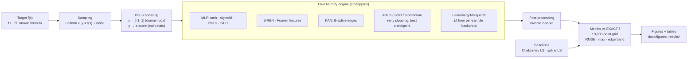

# Neural network as a device for function approximation

**Soft Computing · Project I (Phase I) · Topic 11** · Wrocław University of Science and Technology, 2026/27
Supervisor: Prof. Jacek Mazurkiewicz · Deadline Phase I: **14 December 2026** · Team of two (Member A, Member B)

A hand-written NumPy engine that learns unknown functions from samples, plus a set of
experiments that test **how well, why, and when not**. Every error is measured against the
**exact** function on a dense grid, so we can tell real approximation quality apart from
fitting the noise.


---

## What is different about this project

The assignment asks for a working engine plus a sensitivity study. We do that (E0-E6) and add
four studies built on recent research, all implemented in our own engine:

| | Unique study | One-line result (quick profile) |
|---|---|---|
| **U1** | **Levenberg-Marquardt** second-order training (own Jacobian via per-sample backprop) | Same 2×16 net, same data: **54-81× lower error** than Adam |
| **U2** | **Kolmogorov-Arnold Network** (ICLR 2025) with own B-splines, grid extension | 74-parameter KAN beats every MLP on f7 and **recovers the formula** exp(sin πx + y²) |
| **U3** | **Spectral bias** measured per frequency, fixed with Fourier features / SIREN / KAN | tanh MLP never learns the 16π component in 3,000 steps; Fourier features learn it in 100 |
| **U4** | **Trust**: deep ensembles + split **conformal prediction** | 90 % intervals hit 90.2 % coverage; noise-weighted version fixes 61 % → 88 % coverage in the noisiest region |

And one honest conclusion the supervisor asks for ("check if the soft-computing solution is
correctly fitted to the problem"): **for smooth 1-D functions a Chebyshev polynomial beats every
network we trained by 2 to 10 orders of magnitude; networks pay off in 2-D, at kinks, and on
compositional structure** (E6, U2).

---

## Pipeline



## Target functions

| key | f(x) | domain | what it tests |
|---|---|---|---|
| f1 | sin(2πx) | [-1, 1] | smooth reference |
| f2 | 2x² | [-2, 2] (test [-3, 3]) | extrapolation |
| f3 | sin πx + ½ sin 4πx + ¼ sin 16πx | [-1, 1] | spectral bias |
| f4 | 1 / (1 + 25x²) | [-1, 1] | Runge phenomenon |
| f5 | Franke's function | [0, 1]² | classic 2-D benchmark |
| f6 | \|x\| | [-1, 1] | non-differentiable point |
| f7 | exp(sin πx + y²) | [-1, 1]² | compositional (KAN toy example) |

## Quick start

```bash
python -m venv .venv && source .venv/bin/activate      # Windows: .venv\Scripts\activate
pip install -e ".[dev]"
pytest                                                  # gradient / Jacobian checks, 27 tests
python -m fapprox targets
python -m fapprox train --target f4 --hidden 16,16 --optimizer lm --epochs 300 --out runs/f4.npz
python -m fapprox predict runs/f4.npz 0 0.5 1
python experiments/run_all.py --profile quick           # all 11 experiments, ~20 min on 2 cores
```

In VS Code: open the folder, accept the recommended extensions, then
*Terminal → Run Task* → `tests` / `experiments: quick profile` / `experiment: single (pick)`.

## Experiments

| id | question | figure |
|---|---|---|
| E0 | Are the derivatives right? How does one hidden layer build a function? | [gradcheck](docs/figures/e0_sanity_gradcheck.png) · [units](docs/figures/e0_sanity_units.png) |
| E1 | Deep or wide at equal parameter count? | [params](docs/figures/e1_architecture_params.png) · [Franke](docs/figures/e1_architecture_franke.png) |
| E2 | Which activation / initialisation for which target? | [dot plot](docs/figures/e2_activation_init_dotplot.png) · [fits](docs/figures/e2_activation_init_fits.png) |
| E3 | Learning rate × batch size; which optimiser? | [heat map](docs/figures/e3_training_lr_batch.png) · [optimisers](docs/figures/e3_training_optimizers.png) |
| E4 | How does error scale with data size and noise? What does overfitting look like? | [N, σ](docs/figures/e4_data_noise_n_sigma.png) |
| E5 | Early stopping vs weight decay | [regularisation](docs/figures/e5_regularisation_regularisation.png) |
| E6 | Is a network the right tool at all? | [scaling](docs/figures/e6_baselines_scaling.png) · [Runge](docs/figures/e6_baselines_runge.png) |
| U1 | Is the gap to classical methods the network's fault or the optimiser's? | [LM vs Adam](docs/figures/u1_levenberg_marquardt_lm_vs_adam.png) |
| U2 | KAN vs MLP at equal size; can we read the formula back? | [params](docs/figures/u2_kan_vs_mlp_params.png) · [interpret](docs/figures/u2_kan_vs_mlp_interpret.png) |
| U3 | Which frequencies are learned when? | [components](docs/figures/u3_spectral_bias_components.png) · [spectrum](docs/figures/u3_spectral_bias_spectrum.png) |
| U4 | Where can the approximation be trusted? | [uncertainty](docs/figures/u4_uncertainty_uncertainty.png) |

All numbers: [docs/RESULTS.md](docs/RESULTS.md) (auto-generated). Protocol: [docs/EXPERIMENTS.md](docs/EXPERIMENTS.md).

### A few pictures

**U1 · Same network, different optimiser.** Levenberg-Marquardt reaches 1e-6 on Runge where Adam stalls near 1e-4.


**U2 · A KAN reads back the formula.** The learned edge functions are sin(πx), y² and exp(·) up to scale and shift.


**U3 · Spectral bias.** Plain networks learn low frequencies first; input encodings remove the delay.


**U4 · Trust.** Ensemble spread grows outside the data but is far too small; conformal intervals keep their promise inside.


**E2 · Activation matters.** ReLU nets represent the kink of |x| exactly; tanh rounds it off.


---

## Repository map

```
src/fapprox/            the engine (NumPy only)
  functions.py          7 target functions
  data.py               sampling, noise, pre/post-processing
  activations.py        tanh, sigmoid, ReLU, SiLU, sine (SIREN)
  layers.py             Dense, FourierFeatures, KANLayer (+ per-sample backprop)
  bspline.py            vectorised Cox-de Boor basis and derivative
  model.py              Network, build_mlp, build_kan, Jacobian
  optim.py              SGD, momentum, Nesterov, Adam
  train.py              mini-batch loop, early stopping, cosine lr, Levenberg-Marquardt
  baselines.py          Chebyshev LS, spline LS, polynomial interpolation
  metrics.py            RMSE, max error, R², edge-band error, vs exact f
  gradcheck.py          finite-difference checks
  serialize.py, cli.py  model files, command line
experiments/            e0…e6, u1…u4, run_all.py, common.py (profiles quick / full)
tests/                  pytest suite
results/<exp>/          runs.csv + summary.md per experiment
docs/                   PROJECT_PLAN · RESEARCH · EXPERIMENTS · REPORT_OUTLINE · RESULTS · figures/
```

## Documents

* [Findings so far](docs/FINDINGS.md) - what the first full quick run shows, in plain words
* [Project plan](docs/PROJECT_PLAN.md) - assumptions, hypotheses, team split, timeline to 14 Dec
* [Research notes](docs/RESEARCH.md) - literature behind every design choice, with links
* [Experiment protocol](docs/EXPERIMENTS.md) - variables, fixed settings, metrics per experiment
* [Report outline](docs/REPORT_OUTLINE.md) - mapping to the five report parts required by the supervisor
* [Contributing](CONTRIBUTING.md) - git workflow for two people

## Publish to GitHub (later)

```bash
git remote add origin https://github.com/<user>/nn-function-approx.git
git push -u origin main
```

## Engine rules we follow

* No ML framework: forward pass, backward pass, Jacobian, optimisers and B-splines are our own code.
  NumPy for arrays, Matplotlib for figures only.
* Every model, seed and data split is reproducible from the run spec in `results/<exp>/runs.csv`.
* Two profiles: **quick** (2 seeds, 2k points, minutes) for development; **full** (5 seeds, 20k points) for the report.
