# funcprox: a neural network as a device for function approximation

[](https://github.com/abhuiyan00/nn-function-approx/actions/workflows/ci.yml)


[](LICENSE)

Type a function, hide the middle of it, and find the closest curve. Neural networks built from
scratch in NumPy compete with classical fits in your browser, and every one is scored against the
**exact** function, including the part it never saw.

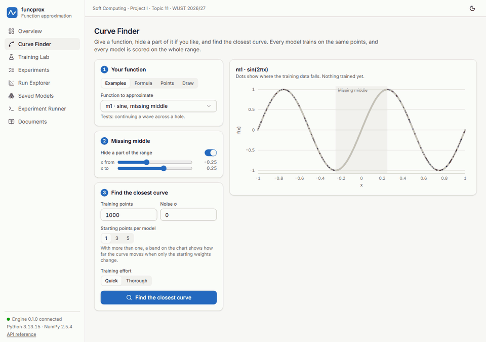

*A live search, sped up. Every model trains on the same points, and none of them sees the shaded part.*

**[Run it](#run-it)** · **[Features](#features)** · **[Requirements](#requirements)** · **[Architecture](#architecture)** · **[Walkthrough](#walkthrough)** · **[Results](#results)** · **[Development](#development)**

Soft Computing, Project I, Topic 11 · Wrocław University of Science and Technology, 2026/27 · Supervisor: Prof. Jacek Mazurkiewicz

## Contents

1. [Features](#features)
2. [Run it](#run-it)
3. [Requirements](#requirements): functional, non-functional, out of scope
4. [Architecture](#architecture): components, one training run, data pipeline, API, technology
5. [Walkthrough](#walkthrough)
6. [Results](#results)
7. [Reference](#reference): target functions, experiments, engine rules
8. [Repository layout](#repository-layout)
9. [Development](#development)
10. [Limitations](#limitations)
11. [Documents](#documents)
12. [Citing](#citing)

## Features

| | |
|---|---|
| **Your function** | Type a formula of one, two or three inputs, paste or upload points, or draw a curve with the mouse. Then hide any part of it, or erase it on the pad |
| **Curve Finder** | Trains nine models on your function, ranks them by how close each curve gets, and answers for any input |
| **Training Lab** | Trains one network live: the fit, the error, the learning curves and the network itself in three dimensions |
| **Looking inside** | Per-unit shares, slope check, loss landscape with the path training took, KAN edges with their closest formula, a replay of the whole training |
| **Trust** | A 90 % band around the curve, calibrated on fresh points, and drawn only where the network had data |
| **Sensitivity** | Varies one setting over several seeds and tells you whether the setting or the luck of the starting weights matters more |
| **Engine** | MLP, SIREN, Fourier features and Kolmogorov-Arnold networks, with Adam and Levenberg-Marquardt training. No ML framework |
| **Experiments** | 12 studies with their results and figures committed, so you can read them without training anything |
| **Take it away** | Save a model, query it later, or export it as one Python file that needs only NumPy |

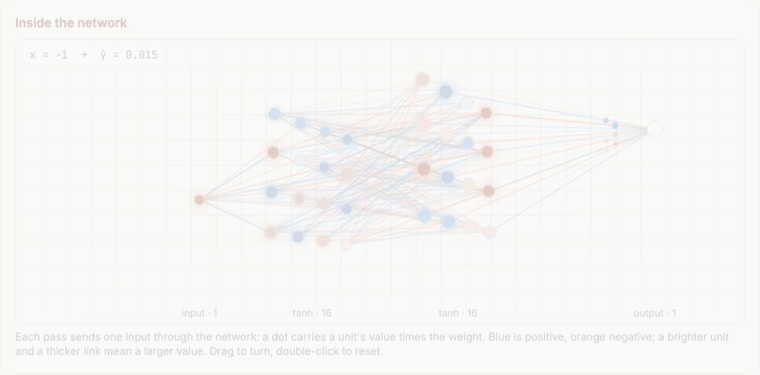

*The network during training. Each pass sends one input through it: units light up with their value, and the links change as the weights are learned.*

## Run it

### Prerequisites

| Tool | Version | Needed for |
|---|---|---|
| [Python](https://www.python.org/downloads/) | 3.10 or newer | the engine, the experiments and the server |
| [Node.js](https://nodejs.org/) | 20.19 or newer | building the interface once. The terminal commands work without it |

### Install and start

**1. Get the code and create an environment**

```bash
git clone https://github.com/abhuiyan00/nn-function-approx.git
cd nn-function-approx
python -m venv .venv
source .venv/bin/activate         # Windows: .venv\Scripts\activate
```

**2. Install the project and build the interface**

```bash
pip install -e ".[ui]"
npm --prefix ui ci
npm --prefix ui run build
```

**3. Start it**

```bash
python -m funcprox ui              # opens http://127.0.0.1:8765
```

Next time you only need to activate the environment and repeat step 3. Press `Ctrl+C` in the terminal to stop.
On Linux and macOS, `make ui` does steps 2 and 3 in one go.

### Without the interface

The engine works from the terminal, without Node.js:

```bash
pip install -e .
python -m funcprox targets
python -m funcprox train --target f4 --hidden 16,16 --optimizer lm --epochs 300 --out runs/f4.npz
python -m funcprox predict runs/f4.npz 0 0.5 1
python -m funcprox train --formula "x^3 - x" --domain=-1.5,1.5 --gap=-0.5,0.5 --hidden 16,16 --optimizer lm --epochs 300
python -m funcprox train --points measured.csv --gap=-0.2,0.2       # one x,y pair per line
python experiments/run_all.py --profile quick        # all 12 experiments, about 25 min on 2 cores
```

Ranges that start with a minus sign need the `=`, as in `--gap=-0.5,0.5`.

## Requirements

The assignment asks for a working approximation device, a study of its sensitivity to its settings, and a check
that a soft-computing solution fits the problem at all. The supervisor added three wishes: functions entered by the
user, a function with a missing middle, and an experiment that finds the closest curve.

### Functional requirements

| ID | The system shall | Where |
|---|---|---|
| FR-01 | implement the forward pass, backward pass, Jacobian and optimisers itself, on NumPy arrays, with no ML framework | [src/funcprox](src/funcprox) |
| FR-02 | offer four network families: MLP (tanh, sigmoid, ReLU, SiLU), SIREN, Fourier features, and KAN with B-spline edges and grid extension | [layers.py](src/funcprox/layers.py), [model.py](src/funcprox/model.py) |
| FR-03 | train with SGD, momentum, Nesterov, Adam and Levenberg-Marquardt, with mini-batches, early stopping on a best checkpoint and L2 weight decay | [train.py](src/funcprox/train.py), [optim.py](src/funcprox/optim.py) |
| FR-04 | accept a target as one of 12 built-in functions, a typed formula of up to three inputs, pasted or uploaded points, or a curve drawn by hand | [custom.py](src/funcprox/custom.py), Curve Finder, Training Lab |
| FR-05 | hide any part of the input range from every model, and still score there, with the error inside and outside the hole reported apart | [functions.py](src/funcprox/functions.py), experiment E7 |
| FR-06 | score every model against the exact function on a 10,000-point grid (RMSE, largest error, R²), or on a held-out fifth of measured points | [metrics.py](src/funcprox/metrics.py) |
| FR-07 | train a panel of nine models on the same points (six networks, a Chebyshev polynomial, a cubic spline, an RBF network), rank them, and show how far each curve moves between starting weights | Curve Finder |
| FR-08 | train one configurable network with a live fit, error curve and learning curves, with a stop button and ten presets that reproduce findings | Training Lab |
| FR-09 | show the network in three dimensions during training: units, weights and one forward pass at a time | Training Lab, *Inside the network* |
| FR-10 | take a finished run apart: share of each hidden unit, slope against the exact derivative, loss landscape with the training path, frequency spectrum, LM damping, and KAN edges with their closest simple formula | Training Lab, analysis panels |
| FR-11 | compare every network with classical fits that use no more fitted values than the network has parameters | Training Lab, *Baselines* |
| FR-12 | draw a 90 % trust band from split conformal prediction on 200 fresh points, and no band where no data was sampled | Training Lab |
| FR-13 | replay the fit over the course of training, by slider or as an animation | Training Lab |
| FR-14 | run a sensitivity study: one setting, 2 to 12 values, 1 to 5 seeds, with the median, the seed range and a verdict on setting against seed | Sensitivity |
| FR-15 | save a trained model, reload it, answer for any input, and export it as a standalone Python file | Saved Models, [export.py](src/funcprox/export.py) |
| FR-16 | provide 12 reproducible experiments in a quick and a full profile, with results and figures in the repository, charts over all recorded runs, and a runner with a live log | [experiments](experiments), Experiments, Run Explorer, Experiment Runner |
| FR-17 | do training, prediction and the experiments from the command line as well | [cli.py](src/funcprox/cli.py) |

### Non-functional requirements

| ID | Quality | Requirement | How it is met and checked |
|---|---|---|---|
| NFR-01 | Correctness | Derivatives are exact, not approximately right | Every layer, the Jacobian and the B-spline derivative are checked against finite differences in the pytest suite and in experiment E0 |
| NFR-02 | Reproducibility | Any number in the repository can be produced again | Data and model seeds are part of every run spec. Each experiment writes `results/<exp>/runs.csv` with one row per run |
| NFR-03 | Honest measurement | A result never looks better than it is | Errors are measured against the exact function, not against noisy samples. Classical baselines sit next to every network. The trust band is not drawn in a hole |
| NFR-04 | Responsiveness | The page stays usable while a network trains | Training runs in a worker thread and sends at most one snapshot per 0.1 s over Server-Sent Events. The LM preset on Runge (321 parameters, 300 iterations) takes about 6 s on a laptop |
| NFR-05 | Bounded resources | No request can exhaust the machine | Every field has a limit: 6 hidden layers of 512 units, 50,000 epochs, 20,000 training points, 5,000 pasted points, 200 characters of formula, 1,500 parameters for LM. The server keeps 40 runs and 10 searches, and thins the stored weight path and replay frames to a fixed budget |
| NFR-06 | Security | A local tool must not become a way into the machine | The server listens on the loopback address only, rejects unknown `Host` headers (DNS rebinding) and cross-origin writes. A formula is parsed into a whitelist of names and operators and is never passed to `eval`. Model names are restricted to a safe pattern |
| NFR-07 | Accessibility | Usable with a keyboard, a screen reader and reduced motion | axe finds no serious violations on any page, in the light and the dark theme. Every chart has a table view and answers the arrow keys. Colour is never the only signal. Animations are switched off under `prefers-reduced-motion` |
| NFR-08 | Usability | A first-time user gets a result without reading anything | A function is loaded at the start, presets train with one click, and a mistake gets a plain message next to the input. The layout works from a 390 px phone to a desktop |
| NFR-09 | Portability | Runs offline on the usual systems | CI runs the tests on Ubuntu and Windows with Python 3.10 and 3.13. Fonts and libraries are bundled, so a demonstration needs no network |
| NFR-10 | Maintainability | Parts can change without breaking each other | The engine does not import the interface. The HTTP contract is typed on both sides (Pydantic, TypeScript) and tested. Lint, type check, unit tests and browser tests run on every push |

### Out of scope

* Graphics cards and large networks: everything is sized for one CPU core.
* Accounts, several users, or access over a network.
* Real measured data sets. The targets are synthetic, so the exact answer is always known.
* Fuzzy and neuro-fuzzy models: the topic is a neural network.

## Architecture

### Components

Three layers, each depending only on the one below it. The engine knows nothing about the web, and the browser
knows nothing about NumPy.

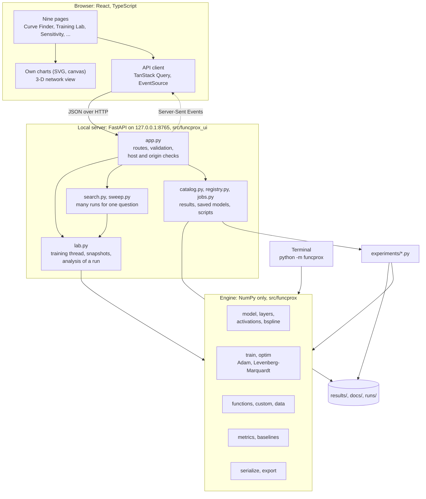

### One training run

What happens between pressing **Train** and the last chart.

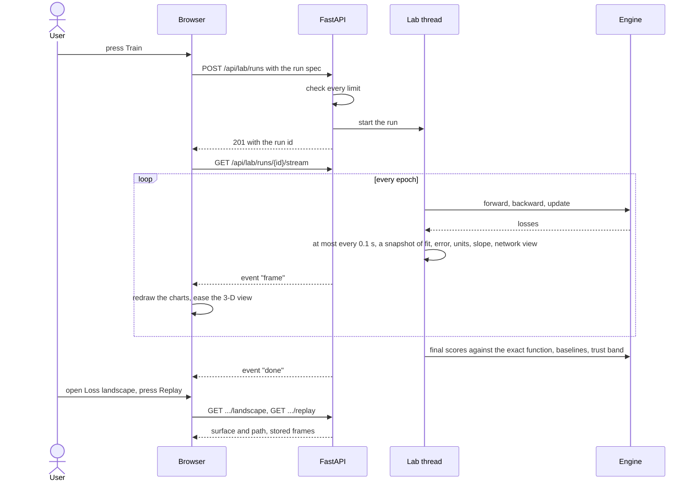

### Data pipeline

Every error is measured against the exact function on a dense grid, so real approximation quality can be told
apart from fitting the noise.

```mermaid
flowchart LR
    F["Your function<br/>built-in, formula, points or drawing"] --> GAP["Missing middle<br/>optional: no data in a hole"]
    GAP --> S["Sampling<br/>uniform x, y = f(x) + noise"]
    S --> PRE["Pre-processing<br/>x → [-1, 1] (domain box)<br/>y → z-score (train stats)"]
    PRE --> ENG
    subgraph ENG["NumPy engine (src/funcprox)"]
        direction TB
        M1["MLP: tanh · sigmoid · ReLU · SiLU"]
        M2["SIREN · Fourier features"]
        M3["KAN: B-spline edges"]
        T1["Adam / SGD / momentum<br/>early stopping, best checkpoint"]
        T2["Levenberg-Marquardt<br/>(J from per-sample backprop)"]
    end
    ENG --> POST["Post-processing<br/>inverse z-score"]
    POST --> EVAL["Metrics vs EXACT f<br/>10,000-point grid<br/>RMSE · max · edge band"]
    EVAL --> RANK["Closest curve<br/>ranking, inside and outside the hole"]
    EVAL --> FIG["Figures + tables<br/>docs/figures, results/"]
    BASE["Baselines<br/>Chebyshev LS · spline LS · RBF network"] --> EVAL
```

Measured points and drawings have no exact function, so a fifth of the points is held out to score on, together with
any points you hid.

### API

The interface talks to the server over these routes. The full, typed description is at `/api/docs` while the server runs.

| Routes | Purpose |
|---|---|
| `GET /api/health`, `/api/overview`, `/api/targets` | engine version, headline numbers, built-in functions |
| `POST /api/functions/preview` | check a formula, points or a drawing, and return the curve to draw |
| `POST /api/lab/runs`, `GET /api/lab/runs/{id}`, `GET .../stream`, `POST .../stop`, `DELETE` | start, read, follow live, stop and remove one training run |
| `GET /api/lab/runs/{id}/replay`, `.../landscape`, `.../export`, `POST .../predict`, `POST .../save` | replay frames, loss surface, Python file, answers for inputs, save to disk |
| `POST /api/search`, `GET /api/search/{id}`, `POST .../stop` | Curve Finder: a panel of models on one function |
| `POST /api/sweeps`, `GET /api/sweeps/{id}`, `POST .../stop` | Sensitivity: one setting over values and seeds |
| `GET /api/models`, `/api/models/{name}`, `.../export`, `POST .../predict` | saved models |
| `GET /api/experiments`, `/api/datasets`, `/api/documents` | committed results, their data files, the documents |
| `POST /api/jobs`, `GET /api/jobs/{id}`, `GET .../stream`, `POST .../cancel` | run an experiment script with a live log |

### Technology

| Layer | Choice | Why |
|---|---|---|
| Engine | Python, NumPy | The assignment is to build the device, so no framework may hide the mathematics |
| Server | FastAPI, uvicorn, Pydantic | Request limits are declared once, as types, and the API documents itself |
| Live updates | Server-Sent Events | The stream goes one way, over plain HTTP, and the browser reconnects by itself |
| Interface | React 19, TypeScript, Vite | One typed contract with the server, and nine pages that share their charts and forms |
| Styling | Tailwind CSS 4, shadcn/ui on Radix | Accessible controls, and every colour is a token with a light and a dark value |
| Charts | Own SVG and canvas charts on d3-scale | Each chart needs a table view, keyboard control and a missing-middle band, which chart libraries do not give together |
| 3-D view | Canvas with its own projection | A few hundred lines instead of a 3-D library. It draws lines and discs, nothing more |
| Tests | pytest, Vitest, Playwright with axe | The engine, the logic of the interface, and the real pages in a real browser |

## Walkthrough

### 1. Find the closest curve

Open **Curve Finder**. It works in three steps from top to bottom, and a function with a missing middle is
already loaded, so you can press **Find the closest curve** straight away. A search takes under half a minute.

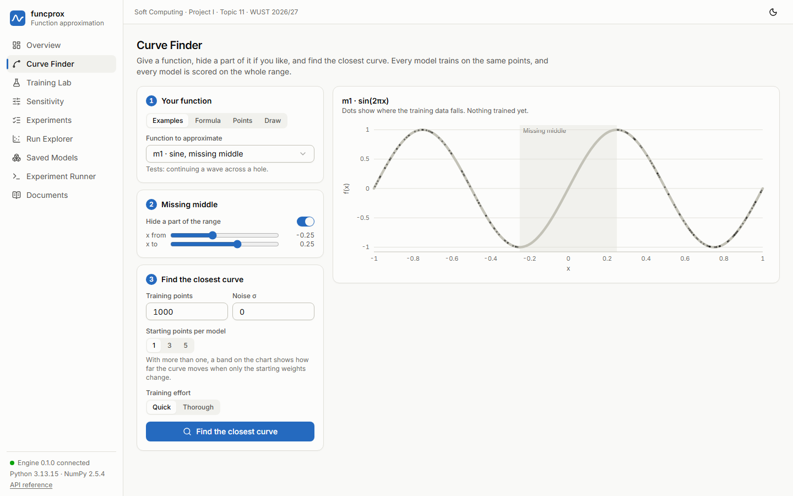

**Step 1: give your function.** There are four ways:

| Tab | What you do |
|---|---|
| **Examples** | Pick one of 12 built-in functions. `m1` to `m5` come with a missing middle |
| **Formula** | Type it, such as `sin(3*x) * exp(-x^2/4)`, and set its range. Using `y` makes it a surface, and `z` adds a third input |
| **Points** | Paste `x, y` lines or open a CSV file. A fifth of the points is held out to score on |
| **Draw** | Draw a curve with the mouse or a finger. A part you leave blank has no data at all. The eraser hides a part from training but keeps it dashed on the pad, so every model is scored on how well it fills that part |

The chart updates while you type, and a mistake gets a plain message at the input.

A formula can use numbers, `x`, `y`, `z`, `pi`, `e`, `+ - * / ^` and `sin cos tan asin acos atan sinh cosh tanh exp log ln log10 sqrt abs sign step floor ceil min max`.
Write multiplication out: `2*x`, not `2x`. Where a formula is undefined, such as `sqrt(x^2 - 0.25)` near zero, it has a natural hole: nothing is sampled or scored there.

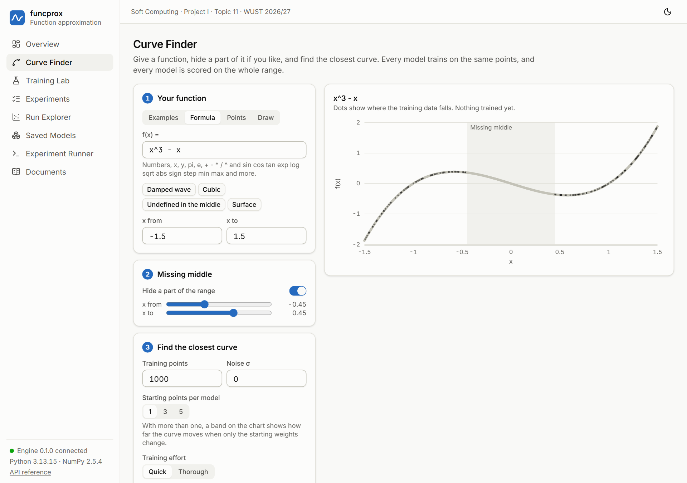

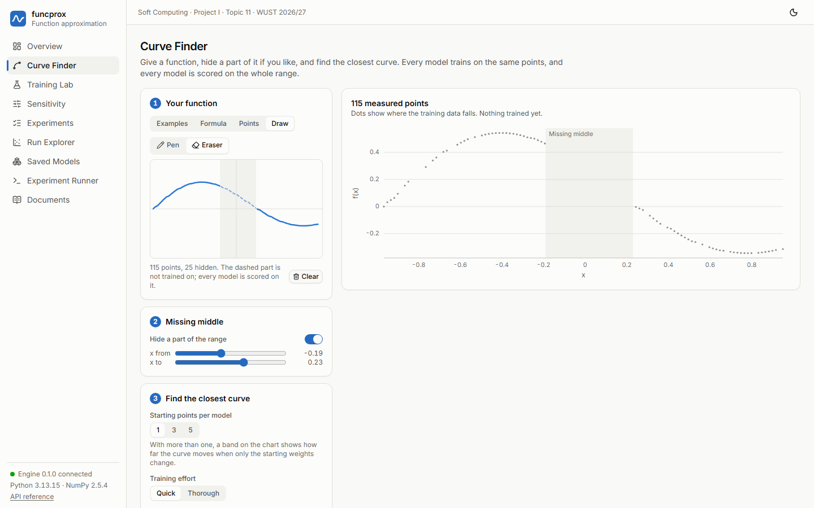

**Step 2: hide the middle.** Turn on **Hide a part of the range** and move the sliders. No model gets any data
inside the shaded band, but the score still covers it. On the draw pad the eraser does the same: the stretch you
erase becomes the band, and the sliders follow it.

**Step 3: find the closest curve.** Set the number of training points and the noise. With 3 or 5 **starting points**,
each model trains that many times, and a band on the chart shows how far the curve moves when only the
starting weights change.

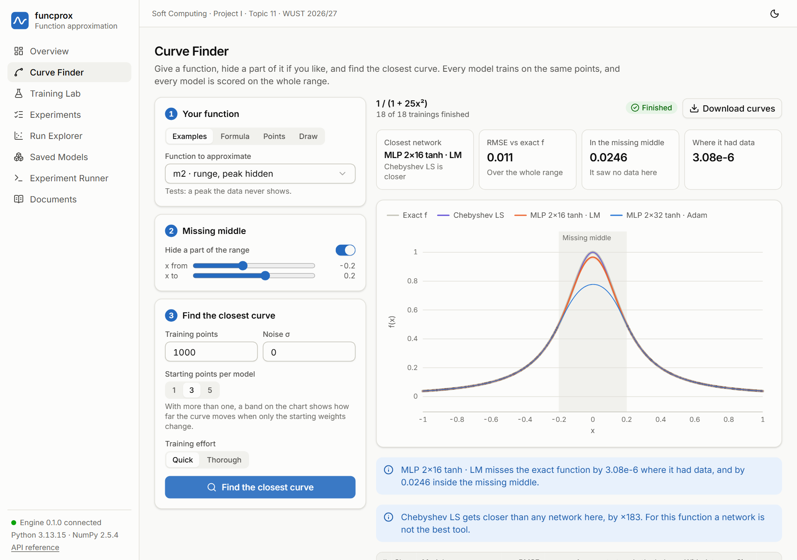

**Read the result.** The table ranks every model by its error over the whole range, with the error inside the hole
and outside it next to it. Tick a row to draw its curve, or open a network in the Training Lab.

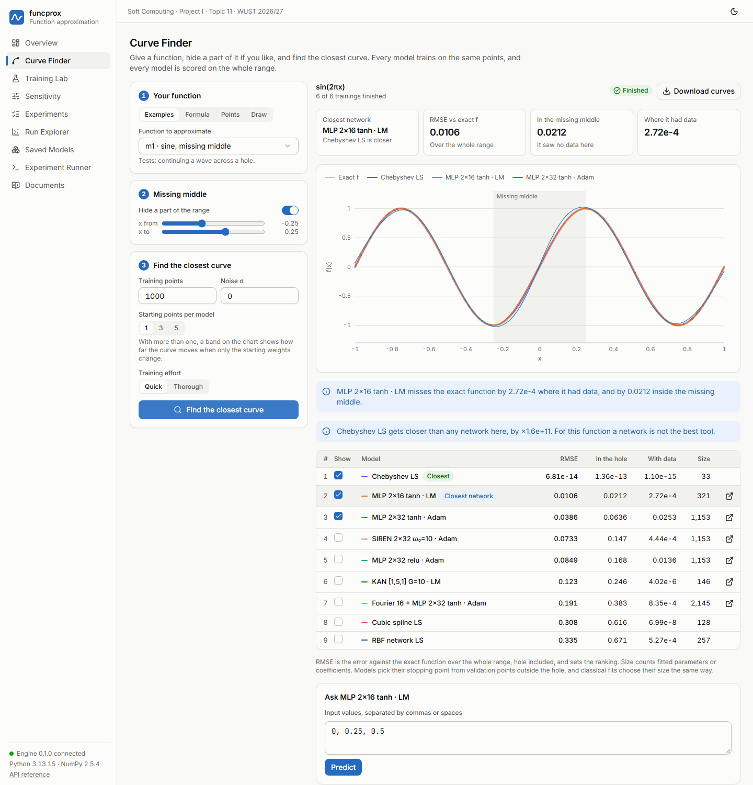

Three labels matter:

* **Closest** is the curve nearest the truth. Without noise this is often a classical polynomial, and the page says so.
* **Closest network** is the best neural network.
* **Best on validation** is what you would pick without knowing the exact function. It is often a different model, because validation points say nothing about the hole.

Below the table, **Ask** gives the closest network's answer for any input, and **Download curves** saves all curves as a CSV file.

### 2. Train one network in the Training Lab

Click any preset at the top. It loads the settings of a finding and starts training, and you watch the
fit, the error against the exact function and the learning curves.
A good first pair: **Adam on Runge**, then **LM on Runge**. Same network, roughly 80 times less error in experiment U1.

To try your own idea, change anything in the panel on the left and press **Train**. The same four ways to give a
function and the same missing middle are at the top of that panel.


*A live run, sped up. The network picks up the slow waves first and misses the fastest one: spectral bias, experiment U3.*

**Inside the network** shows the network itself in three dimensions while it trains. Each pass sends one input
through it: units light up with their value, dots carry a unit's value times the weight, and the links change
as the weights are learned. Drag to turn the view. Layers wider than 24 units are thinned to 24 for drawing.


#### Take the result apart

The panel at the bottom of a finished run answers one question per tab. A tab appears only where it applies.

| Tab | Question | Shown for |
|---|---|---|
| **Spectrum** | Which frequencies has the network learned so far? | one input and an exact function |
| **Baselines** | Would a polynomial, a spline or an RBF network of the same size do better? | every run |
| **Units** | How does the last hidden layer add up to the answer? | MLP with one input |
| **Slope** | The curve is close. Is its derivative right too? | one input and an exact function |
| **Damping μ** | When did Levenberg-Marquardt act like Gauss-Newton, and when like gradient descent? | LM |
| **Edges** | What did each edge of a KAN learn, and which simple formula is closest? | KAN |
| **Loss landscape** | What did the error surface look like along the path training took? | every finished run |
| **Compare** | How do the runs of this session differ? | every run |

**Units.** The answer of an MLP is a weighted sum of its last hidden layer. Each thin curve is one unit's share,
and the thick curve is their sum: the network.

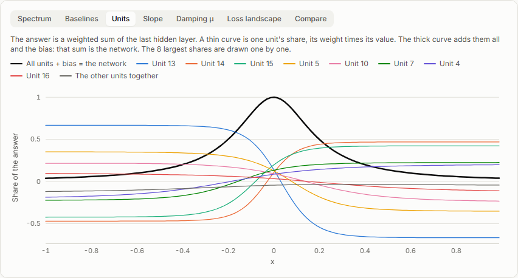

**Slope.** The derivative of the network comes from the chain rule through its layers. Small ripples in a fit
become large in its slope, so this check is stricter than the error of the curve.

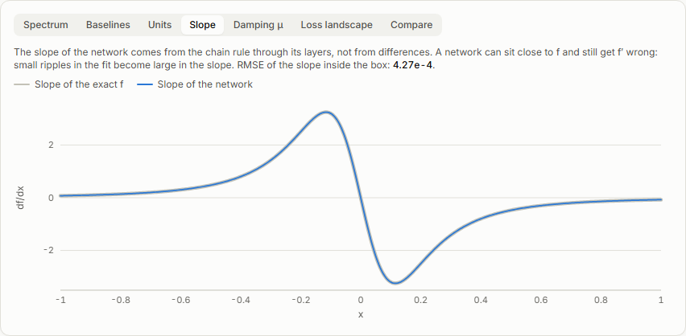

**Loss landscape.** The training error over the plane that holds most of the path the weights took
(Li et al., 2018), with the path drawn on it from the starting weights to the trained network.

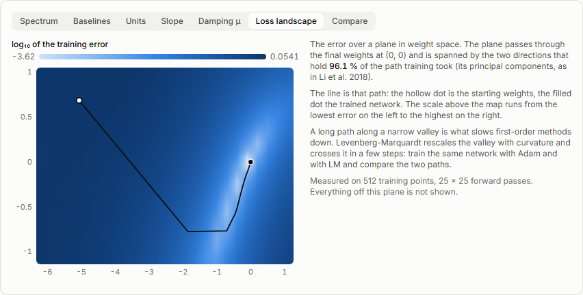

**Baselines.** Least-squares fits on the same training points, each no larger than the network.
The page says plainly when a classical fit wins.

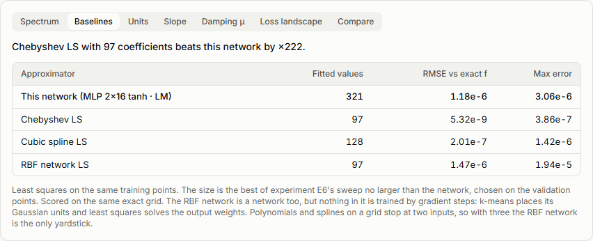

**Edges.** A KAN learns a function on every edge. Each edge is compared with a short list of simple forms, and the
closest is drawn under it. On `exp(sin(πx) + y²)` the three edges come out as a sine, a square and an exponential.

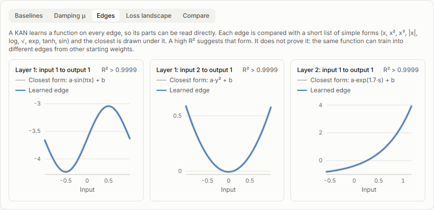

#### How far to trust it

After training, 200 fresh points that were never used to train or to stop set the width of a band: 9 of 10 new
points fall inside it. The promise holds only where data was sampled, so the band stops at a missing middle
instead of pretending to know.

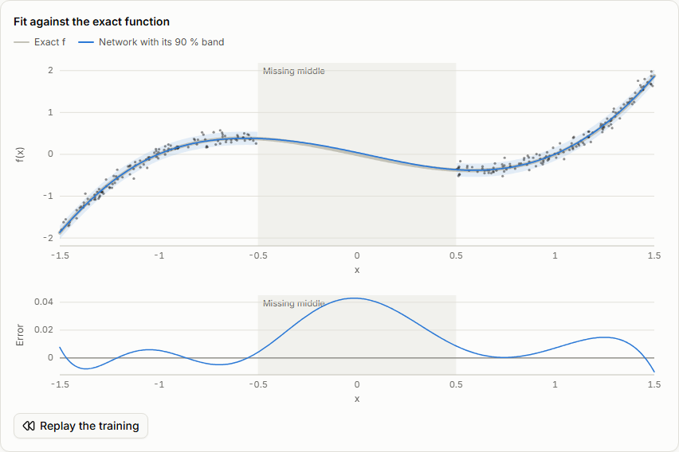

#### Replay, three inputs, export

**Replay the training** steps through the fit as it was during training, by slider or as an animation.

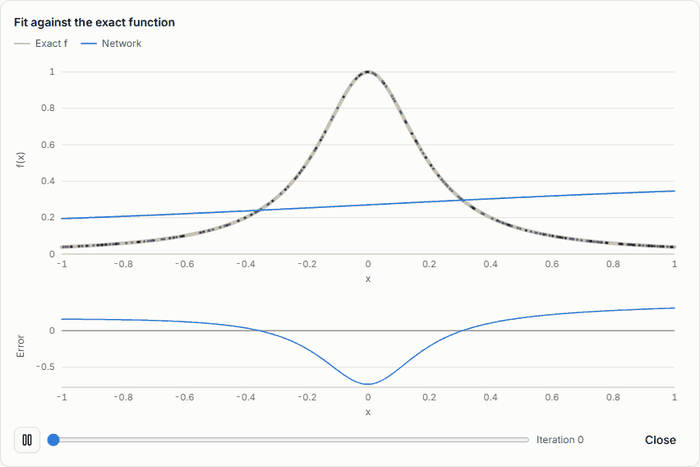

A formula with `z` has three inputs. The network trains and is scored on the whole box, and the page shows the
slice through the middle of the third input.

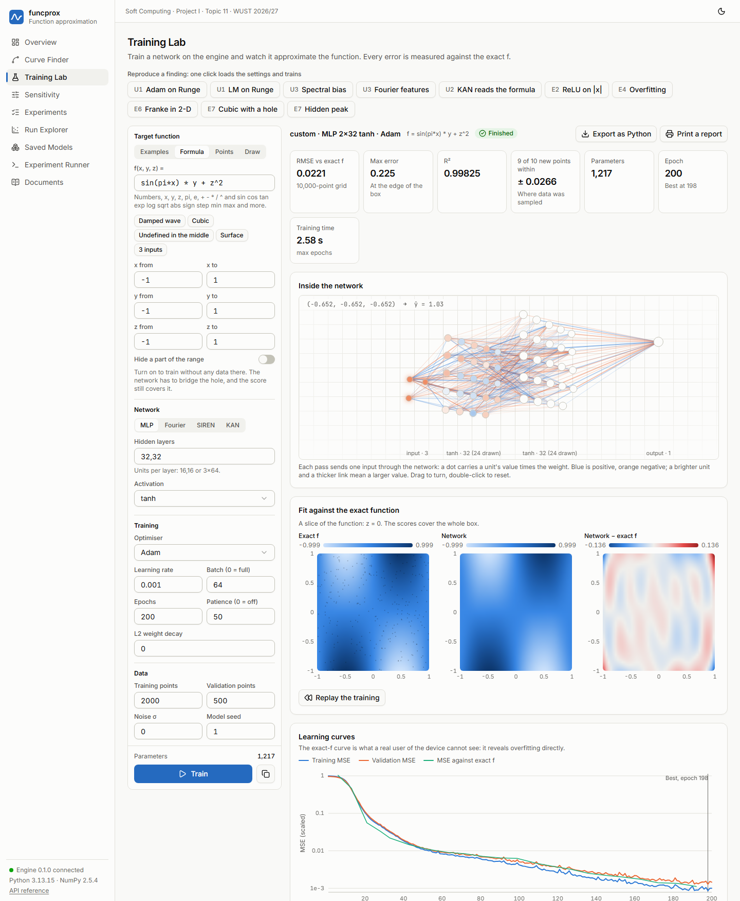

**Export as Python** downloads the trained network as one file that needs only NumPy: the weights, the scaling
and a `predict(x)` function. **Print a report** lays the run out for paper or PDF.

The interface has a light and a dark theme, and both pass the same accessibility checks.

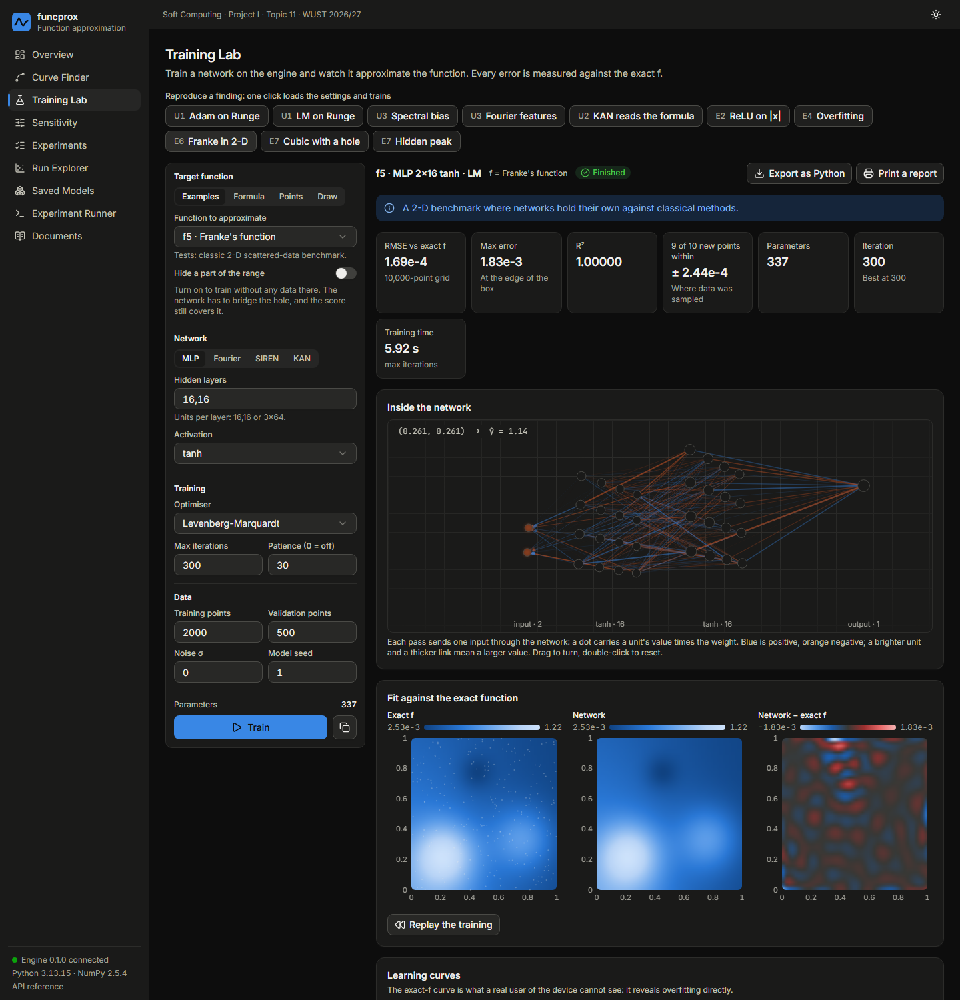

### 3. Ask how much a setting matters

**Sensitivity** takes the settings of the Training Lab, varies one of them and trains every value on several
seeds. Each point is the median of the seeds and the band is their range. The page then says whether the setting
or the starting weights changes the error more. Any row opens its best run in the Lab.

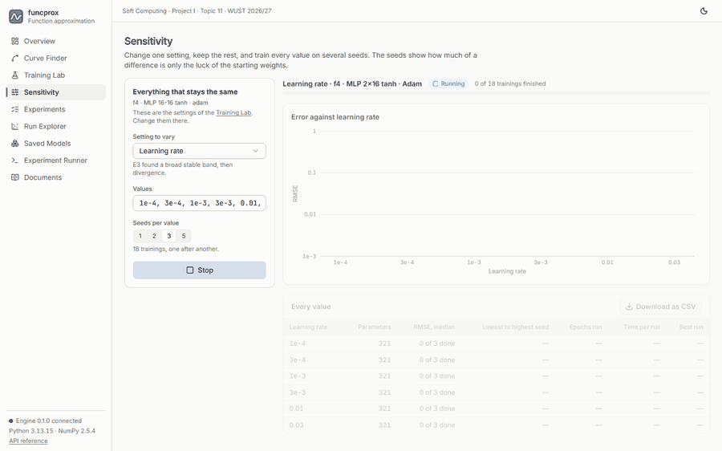

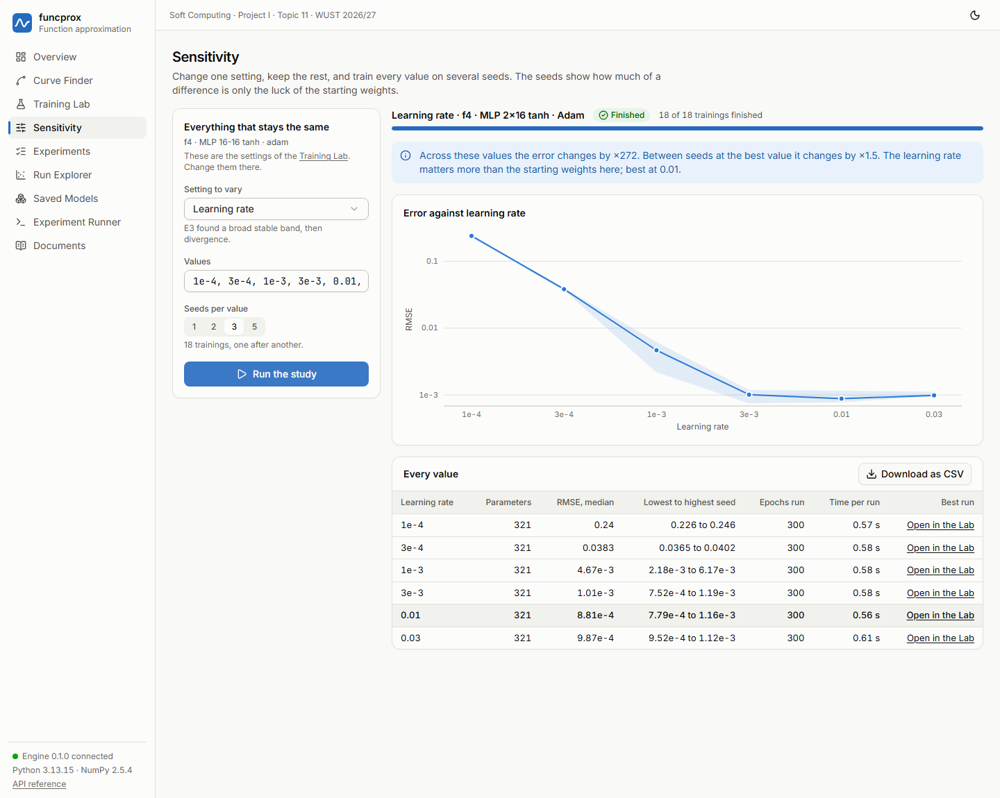

### 4. See the whole project on the Overview

The headline numbers and the main question: is a network the right tool for this target? Everything
is computed from the result files in the repository.


### 5. Read an experiment

**Experiments** lists all 12 studies. Each one shows its question, hypothesis and findings, then
interactive charts, summary tables, the report figures and the raw runs.


### 6. Compare runs in the Run Explorer

Plot any measurement against any setting across all recorded runs. The address keeps your choices, so a
view can be shared by copying the link.


### 7. Save a model and query it

After a run in the Lab, press the **Save** button. **Saved Models** reloads the file, checks it against the
exact function, answers for any input you type and exports the model as a Python file.


### 8. Re-run the experiments

**Experiment Runner** runs the scripts one at a time with a live log, and the rest of the interface picks up
the new results when a run ends.

> A run overwrites the tracked files in `results/` and `docs/figures/`. Commit your work first, so you can
> compare or go back. The **quick** profile takes minutes per experiment, the **full** profile takes hours.


### 9. Read the documents

**Documents** shows this README and everything in `docs/`, always the version on disk.


## Results

The assignment asks for a working engine and a sensitivity study (E0-E6). Four more studies build on recent
research, in the same engine. These numbers come from the quick profile.

| | Study | Result |
|---|---|---|
| **U1** | **Levenberg-Marquardt** second-order training, with the Jacobian from per-sample backprop | Same 2×16 network, same data: **54-81× lower error** than Adam |
| **U2** | **Kolmogorov-Arnold Network** (ICLR 2025) with B-splines and grid extension | A 74-parameter KAN beats every MLP on f7 and **recovers the formula** exp(sin πx + y²) |
| **U3** | **Spectral bias** measured per frequency, fixed with Fourier features, SIREN or a KAN | A tanh MLP never learns the 16π component in 3,000 steps; Fourier features learn it in 100 |
| **U4** | **Trust**: deep ensembles and split **conformal prediction** | 90 % intervals hit 90.2 % coverage; a noise-weighted version lifts the noisiest region from 61 % to 88 % |

And the honest conclusion the supervisor asks for ("check if the soft-computing solution is correctly fitted to
the problem"): **for smooth 1-D functions a Chebyshev polynomial beats every network we trained by 2 to 10 orders
of magnitude. Networks pay off in 2-D, at kinks and on compositional structure** (E6, U2).

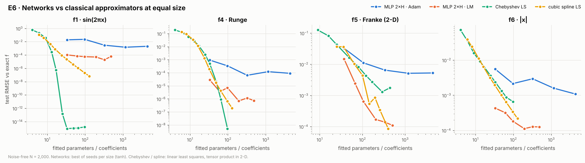

**E7 · The missing middle.** A network can miss the function by 5e-7 where it had data and by 0.12 inside the hole.
Without noise a Chebyshev polynomial bridges the hole best in 18 of 20 settings; with noise a 2×16 network trained with
Levenberg-Marquardt is closest most often. Validation points picked the model closest inside the hole in only 21 of 40 settings.

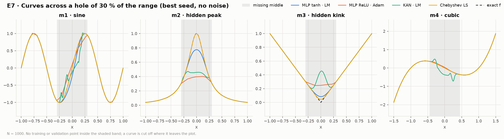

**U1 · Same network, different optimiser.** Levenberg-Marquardt reaches 1e-6 on Runge where Adam stalls near 1e-4.

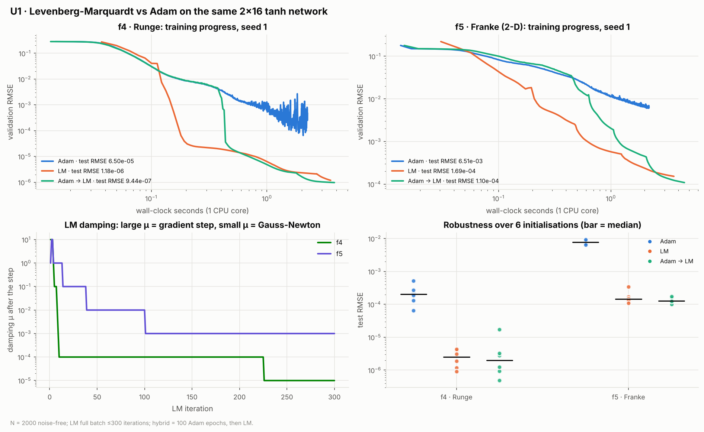

**U2 · A KAN reads back the formula.** The learned edge functions are sin(πx), y² and exp(·) up to scale and shift.

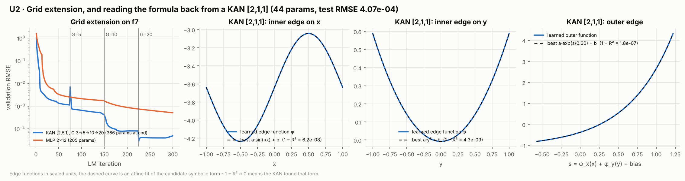

**U3 · Spectral bias.** Plain networks learn low frequencies first; input encodings remove the delay.

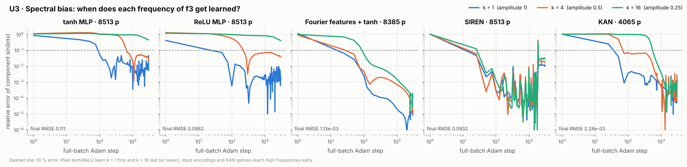

**U4 · Trust.** Ensemble spread grows outside the data but is far too small; conformal intervals keep their promise inside.

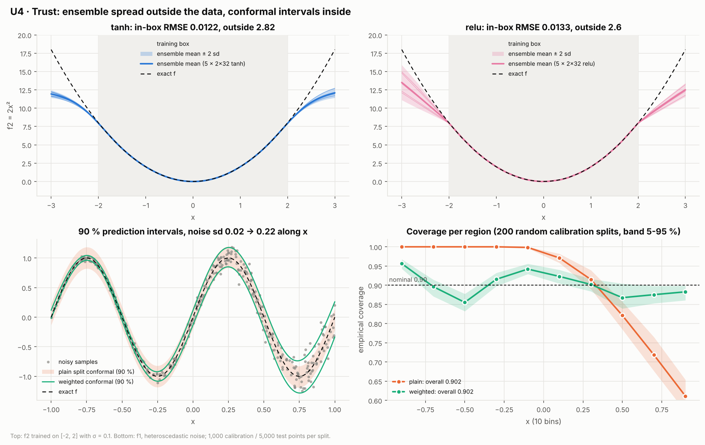

**E2 · Activation matters.** ReLU networks represent the kink of |x| exactly; tanh rounds it off.

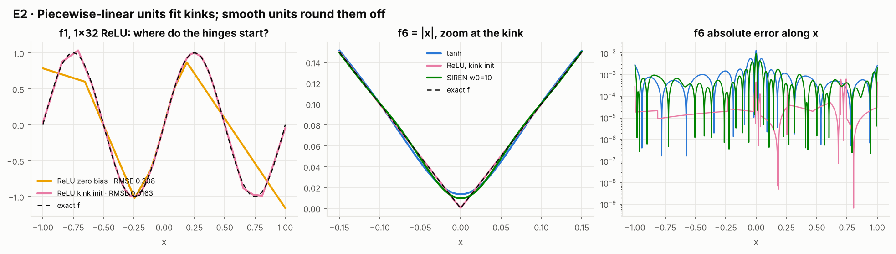

All numbers are in [docs/RESULTS.md](docs/RESULTS.md), and the plain-language reading is in [docs/FINDINGS.md](docs/FINDINGS.md).

## Reference

### Target functions

| key | f(x) | domain | what it tests |
|---|---|---|---|
| f1 | sin(2πx) | [-1, 1] | smooth reference |
| f2 | 2x² | [-2, 2] (test [-3, 3]) | extrapolation |
| f3 | sin πx + ½ sin 4πx + ¼ sin 16πx | [-1, 1] | spectral bias |
| f4 | 1 / (1 + 25x²) | [-1, 1] | Runge phenomenon |
| f5 | Franke's function | [0, 1]² | classic 2-D benchmark |
| f6 | \|x\| | [-1, 1] | non-differentiable point |
| f7 | exp(sin πx + y²) | [-1, 1]² | compositional (KAN toy example) |

With a missing middle, where no model gets any data:

| key | f(x) | domain | hole | what it tests |
|---|---|---|---|---|
| m1 | sin(2πx) | [-1, 1] | [-0.25, 0.25] | continuing a wave |
| m2 | 1 / (1 + 25x²) | [-1, 1] | [-0.2, 0.2] | a peak the data never shows |
| m3 | \|x\| | [-1, 1] | [-0.3, 0.3] | a hidden kink |
| m4 | x³ - x | [-1.5, 1.5] | [-0.5, 0.5] | recovering a simple shape |
| m5 | exp(sin πx + y²) | [-1, 1]² | [-0.3, 0.3]² | a square hole in a surface |

### Experiments

| id | question | figure |
|---|---|---|
| E0 | Are the derivatives right? How does one hidden layer build a function? | [gradcheck](docs/figures/e0_sanity_gradcheck.png) · [units](docs/figures/e0_sanity_units.png) |
| E1 | Deep or wide at equal parameter count? | [params](docs/figures/e1_architecture_params.png) · [Franke](docs/figures/e1_architecture_franke.png) |
| E2 | Which activation / initialisation for which target? | [dot plot](docs/figures/e2_activation_init_dotplot.png) · [fits](docs/figures/e2_activation_init_fits.png) |
| E3 | Learning rate × batch size; which optimiser? | [heat map](docs/figures/e3_training_lr_batch.png) · [optimisers](docs/figures/e3_training_optimizers.png) |
| E4 | How does error scale with data size and noise? What does overfitting look like? | [N, σ](docs/figures/e4_data_noise_n_sigma.png) |
| E5 | Early stopping vs weight decay | [regularisation](docs/figures/e5_regularisation_regularisation.png) |
| E6 | Is a network the right tool at all? | [scaling](docs/figures/e6_baselines_scaling.png) · [Runge](docs/figures/e6_baselines_runge.png) |
| E7 | How close can a curve get where it saw no data, and can the data tell you which curve is closest? | [fits](docs/figures/e7_missing_middle_fits.png) · [width](docs/figures/e7_missing_middle_width.png) |
| U1 | Is the gap to classical methods the network's fault or the optimiser's? | [LM vs Adam](docs/figures/u1_levenberg_marquardt_lm_vs_adam.png) |
| U2 | KAN vs MLP at equal size; can we read the formula back? | [params](docs/figures/u2_kan_vs_mlp_params.png) · [interpret](docs/figures/u2_kan_vs_mlp_interpret.png) |
| U3 | Which frequencies are learned when? | [components](docs/figures/u3_spectral_bias_components.png) · [spectrum](docs/figures/u3_spectral_bias_spectrum.png) |
| U4 | Where can the approximation be trusted? | [uncertainty](docs/figures/u4_uncertainty_uncertainty.png) |

### Engine rules

* No ML framework: the forward pass, backward pass, Jacobian, optimisers and B-splines are implemented in this
  repository. NumPy for arrays, Matplotlib for figures only.
* Every model, seed and data split can be reproduced from the run spec in `results/<exp>/runs.csv`.
* Two profiles: **quick** (2 seeds, 2k points, minutes) for development, **full** (5 seeds, 20k points) for the report.

## Repository layout

```
src/funcprox/           the engine (NumPy only)
  functions.py          12 target functions, 5 of them with a missing middle
  custom.py             functions a user brings: safe formula parser, measured points, holes
  data.py               sampling, noise, pre/post-processing
  activations.py        tanh, sigmoid, ReLU, SiLU, sine (SIREN)
  layers.py             Dense, FourierFeatures, KANLayer (+ per-sample backprop)
  bspline.py            vectorised Cox-de Boor basis and derivative
  model.py              Network, build_mlp, build_kan, Jacobian
  optim.py              SGD, momentum, Nesterov, Adam
  train.py              mini-batch loop, early stopping, cosine lr, Levenberg-Marquardt
  baselines.py          Chebyshev LS, spline LS, polynomial interpolation, RBF network
  metrics.py            RMSE, max error, R², edge-band error, vs exact f
  gradcheck.py          finite-difference checks
  serialize.py          model files
  export.py             a trained network as one standalone Python file
  cli.py                command line
src/funcprox_ui/        the server (FastAPI)
  app.py                routes, host and origin checks, static files
  schemas.py            request types with their limits
  lab.py                one training run: thread, snapshots, analysis, trust band, loss landscape
  search.py, sweep.py   Curve Finder panel, sensitivity study
  catalog.py            results and documents from disk
  registry.py, jobs.py  saved models, experiment scripts
ui/                     the interface (React, TypeScript, Vite)
  src/pages/            one file per page; the lab is in src/pages/lab/
  src/components/       charts, function input, shared controls
  src/lib/              API types, formatting, the 3-D projection, sensitivity logic
  e2e/                  browser and accessibility tests
  scripts/capture.mjs   makes every screenshot and GIF in this README
experiments/            e0…e7, u1…u4, run_all.py, common.py (profiles quick / full)
tests/                  pytest suite
results/<exp>/          runs.csv + summary.md per experiment
docs/                   plan, research notes, protocol, results, figures/, screenshots/
```

## Development

```bash
pip install -e ".[dev,ui]"
pytest                               # engine, gradients, Jacobian, HTTP contract, textbook claims
npm --prefix ui run lint
npm --prefix ui test                 # logic of the interface
npm --prefix ui run build
npm --prefix ui run e2e              # real pages in a browser, with axe; about 5 min
```

| Suite | Tool | Tests | Covers |
|---|---|---|---|
| Engine and API | pytest | 230 | derivatives against finite differences, training, formulas, every route and its refusals |
| Textbook claims | pytest | 18 | Runge's phenomenon, Chebyshev and RBF convergence, width, noise averaging, no extrapolation, the cost of a hole, reproducibility |
| Interface logic | Vitest | 111 | formatting, chart scales, the 3-D projection, formula and sensitivity helpers |
| Browser | Playwright, axe | 75 | every page end to end against the real engine, on a phone, in both themes, and a full class exercise with the eraser |

CI runs all three on every push and pull request: pytest on Ubuntu and Windows with Python 3.10 and 3.13,
and the interface checks on Ubuntu.

The pictures in this README come from the real interface and can be made again:

```bash
npm --prefix ui run build
npm --prefix ui run capture          # every screenshot and GIF, about three minutes
```

Frontend development is described in [ui/README.md](ui/README.md), the git workflow in
[CONTRIBUTING.md](CONTRIBUTING.md), and what changed in [CHANGELOG.md](CHANGELOG.md). Found a bug or a result that
does not reproduce? [Open an issue](https://github.com/abhuiyan00/nn-function-approx/issues/new/choose). In VS Code, accept the recommended extensions and use
*Terminal → Run Task*.

## Limitations

* **Synthetic targets.** Every built-in function has a known formula. The experiments cover one and two inputs.
  The interface also takes three, and shows such a fit as a slice.
* **Levenberg-Marquardt is for small networks.** It solves a system the size of the parameter count on every
  iteration, so the interface limits it to 1,500 parameters.
* **The trust band is an average promise.** It covers 90 % of new points drawn like the training data, not 90 %
  at every single input, and it says nothing inside a hole. It is available when the exact function is known.
* **The loss landscape is a plane.** It shows two directions of a space with hundreds of them.
* **The closest formula of a KAN edge is a suggestion.** A high R² does not prove the form, and other starting
  weights can train into other edges.
* **Nothing is stored between sessions except saved models.** Lab runs, searches and studies live in the server's
  memory and end when it stops. Saved models stay in `runs/`.
* **No login.** The server listens on the loopback address only. Do not expose it to a network.
* **Quick profile.** The numbers under [Results](#results) use 2 seeds and 2,000 points.

## Documents

* [Findings so far](docs/FINDINGS.md): what the first full quick run shows, in plain words
* [Project plan](docs/PROJECT_PLAN.md): assumptions, hypotheses, team split, timeline
* [Research notes](docs/RESEARCH.md): literature behind every design choice, with links
* [Experiment protocol](docs/EXPERIMENTS.md): variables, fixed settings, metrics per experiment
* [Report outline](docs/REPORT_OUTLINE.md): mapping to the five report parts required by the supervisor
* [Results](docs/RESULTS.md): all tables and figures, generated by the experiments

## Citing

If this project helps your work, please cite it. GitHub shows the entry under *Cite this repository*,
and [CITATION.cff](CITATION.cff) holds it:

```bibtex
@software{funcprox,
  author = {Bhuiyan, Alimuzzaman Farhan},
  title  = {funcprox: a neural network as a device for function approximation},
  year   = {2026},
  url    = {https://github.com/abhuiyan00/nn-function-approx}
}
```

## License

[MIT](LICENSE)
