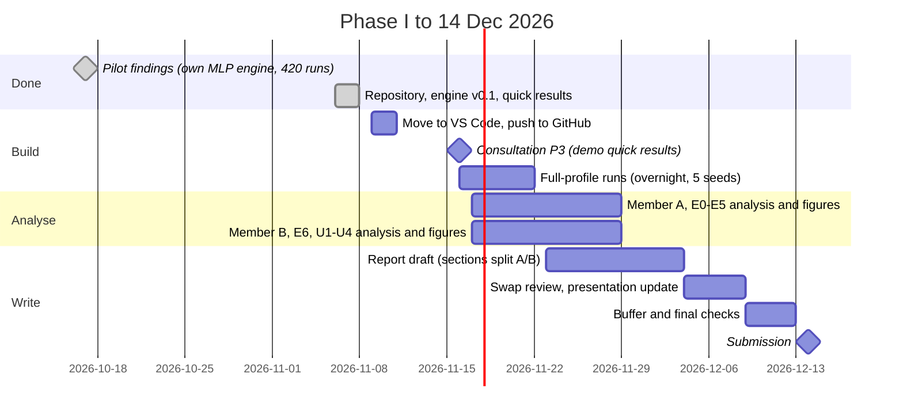

# Project plan · Topic 11 · Neural network as a device for function approximation

Phase I of *Soft Computing - Project*, WUST 2026/27. Supervisor: Prof. Jacek Mazurkiewicz
(room 225, C-3; consultations Wed and Fri 09:00-11:00). Deadline Phase I: **Monday 14 December 2026**.

## 1. Problem statement

A "device" receives an input vector x and returns y = f(x), but its formula is unknown to the
device's user. We only observe samples (x_i, y_i), possibly with measurement noise. The task is
to build a neural network that, after training on the samples, returns ŷ(x) ≈ f(x) for *new*
inputs, and to study how the quality of this approximation depends on the network and on the
training.

Because we choose the test functions ourselves, we know the exact f. This lets us score the
network against the truth on a dense grid, which a real user of the device cannot do. We use
this to separate three things that are mixed together in practice: approximation error (the
network family cannot represent f), optimisation error (training did not find the best
weights), and estimation error (finite noisy data).

## 2. Assumptions

| # | Assumption | Why |
|---|---|---|
| A1 | Inputs lie in a known box (1-D interval or 2-D square). | Lets us scale inputs to [-1, 1] without looking at the data; defines "inside" vs "extrapolation". |
| A2 | f is continuous on the box; f6 is continuous but not differentiable; f2 is tested outside its box. | Universal approximation theorems need continuity on a compact set. |
| A3 | Label noise is additive Gaussian, ε ~ N(0, σ²), independent of x (E4, E5); heteroscedastic σ(x) only in U4. | Standard regression setting; σ is a controlled experimental factor. |
| A4 | Training inputs are uniform random in the box; the test set is a fixed 10,000-point grid (100 × 100 in 2-D) of exact values. | Random design for training, exhaustive deterministic scoring. |
| A5 | One scalar output. | All targets are scalar; it also keeps the Levenberg-Marquardt Jacobian an N × P matrix. |
| A6 | Data seed fixed (0); model seeds vary the initial weights and mini-batch order only. | Seed spread then measures sensitivity to the starting point, as the assignment asks. |
| A7 | A missing middle is a box with no training or validation point; the exact f still scores it (E7). Where a typed formula is undefined, nothing is sampled or scored. | Separates what the network was shown from what it has to bridge on its own. |
| A8 | Measured points have no exact f, so a fifth of them is held out to score on, together with any points hidden in a missing middle. | Without a formula, unseen points are the only honest measure. |

## 3. Objectives and hypotheses

| Exp. | Hypothesis to confirm or reject |
|---|---|
| E0 | Analytic gradients match finite differences to ≤ 1e-6 for every layer type. One hidden layer of a few tanh units already approximates a smooth function. |
| E1 | At equal parameter count, deeper networks reach lower error than one wide layer. |
| E2 | Smooth activations suit smooth targets; ReLU suits kinks; zero-bias ReLU initialisation slows 1-D training. |
| E3 | There is a broad stable band of learning rates; too large a batch with a fixed epoch budget under-trains. |
| E4 | Test error falls with N and is bounded below by the noise; overfitting becomes visible only against the exact f. |
| E5 | Too short an early-stopping patience stops on a plateau; moderate weight decay helps, strong decay underfits. |
| E6 | Classical approximators (Chebyshev, splines) beat MLPs on smooth 1-D functions; MLPs are competitive in 2-D and on kinks. |
| E7 | Inside a missing middle the error is set by what the model assumes, not by how well it fits the data: it grows with the width of the hole, and validation points outside the hole cannot tell which curve is closest inside it. |
| U1 | The gap to classical methods is largely an *optimisation* gap: second-order LM closes much of it. |
| U2 | KANs win when the target has Kolmogorov-Arnold structure, and their edges can be read as formulas; not everywhere. |
| U3 | Plain MLPs learn low frequencies first (spectral bias); Fourier features, SIREN and KAN reduce it. |
| U4 | Ensemble spread signals extrapolation; split conformal intervals keep their nominal coverage, a noise-weighted score keeps it per region. |

## 4. Team split (two people)

Both members know the whole engine; each *owns* a part, writes its report sections and reviews
the other's pull requests. Names are to be filled in.

| | Member A - "classical core" | Member B - "beyond the textbook" |
|---|---|---|
| Engine | Dense layer, activations, Adam/SGD loop, early stopping, data pipeline | Levenberg-Marquardt, KAN + B-splines, Fourier features, SIREN, baselines |
| Experiments | E0, E1, E2, E3, E4, E5 | E6, E7, U1, U2, U3, U4 |
| Report | 1. problem & assumptions · 2. input data & pre-processing · 3. output data & post-processing | 4. topology & tuned parameters · 5. results analysis & final remarks |
| Presentation | Part A: problem, engine, sensitivity study | Part B: baselines, unique studies, conclusions |
| Shared | tests, code review, final remarks, rehearsal | |

## 5. Timeline

## 6. Deliverables

1. Source code of the engine and experiments (this repository), with tests.
2. Final report covering the five parts required by the supervisor (see [REPORT_OUTLINE.md](REPORT_OUTLINE.md)).
3. Figures and result tables, regenerated from `experiments/run_all.py --profile full`.
4. Presentation (interactive deck from 17 Oct, updated with the new results).

## 7. Risks and mitigations

| Risk | Mitigation |
|---|---|
| Supervisor does not accept NumPy as "own software" | Engine uses no ML library; derivatives, optimisers and splines are our code (ask at P3). |
| Full profile takes too long | Run overnight; LM is capped at 4,000 points; `--only` runs a subset. |
| Differences between seeds hide real effects | Report seed min-max bands; claim an effect only when it exceeds the seed spread (pilot: differences < 1.5× need more seeds). |
| KAN results depend on grid range handling | Grid-range update at fixed iterations, documented; compare at equal parameters and same optimiser. |
| Unequal workload | Ownership table above; weekly 30-min sync; pull requests reviewed by the partner. |

## 8. Questions for the supervisor (P3)

1. Is a NumPy-only engine acceptable as "own software" (no PyTorch / TensorFlow)?
2. Report format and submission place (PDF by e-mail, e-portal, printed)?
3. Is the A/B split of the work and of the report acceptable for a pair?
4. Are the four extra studies (LM, KAN, spectral bias, conformal) welcome, or should the report focus on the classical MLP sensitivity study?

## 9. Link to the pilot (17 Oct)

The pilot found five changes to make; all are implemented here:

| Pilot recommendation | Where |
|---|---|
| Patience 50 + best checkpoint | `TrainConfig(patience=50, restore_best=True)` default; E5 studies patience |
| ReLU: random first-layer kinks | `bias_init="kink"` in `Dense`; E2 compares zero vs kink |
| Keep the N sweep | E4: N = 100 … 5,000 at equal update budget |
| Test vs exact f separate from val vs noisy labels | `metrics.evaluate` reports both; E4 overfitting panel |
| Baselines at matched parameter count | E6, U2 |
