# Results

Auto-generated by `experiments/run_all.py` from `results/<experiment>/summary.md`.
Figures are in `docs/figures/`, raw per-run rows in `results/<experiment>/*.csv`.
All errors are measured against the **exact** target on a dense grid (10,000 points),
not against noisy labels, unless a column says otherwise.

## E0 · Engine sanity and universal approximation

_Profile: **quick** · generated 2026-11-06 22:13_

### Gradient check (64 random 2-D points)

| model | params | loss-gradient error | Jacobian error |
|---|---|---|---|
| tanh 2x16 | 337 | 1.6e-10 | 9.1e-11 |
| sigmoid 2x16 | 337 | 1.1e-10 | 2.3e-10 |
| silu 2x16 | 337 | 1.6e-10 | 1.7e-10 |
| sine (SIREN) 2x16 | 337 | 1.3e-10 | 1.3e-10 |
| relu 2x16 (kink init) | 337 | 8.7e-11 | 1.8e-10 |
| Fourier feat. + tanh | 289 | 2.3e-10 | 1.3e-10 |
| KAN [2,4,1] G=5 | 113 | 1.5e-10 | 1.9e-10 |

Gradient error = max |numerical − analytic| / max |analytic| over 200 random coordinates. A ReLU network can exceed 1e-6 only when a ±1e-6 probe pushes a pre-activation across 0 (the derivative does not exist there); smooth layers are not affected.

### Universal approximation, target f1 = sin(2πx)

| hidden units | params | test RMSE | max error |
|---|---|---|---|
| 1 | 4 | 0.651 | 1.13 |
| 2 | 7 | 0.257 | 0.842 |
| 4 | 13 | 3.81e-03 | 0.0249 |
| 8 | 25 | 1.03e-04 | 8.95e-04 |

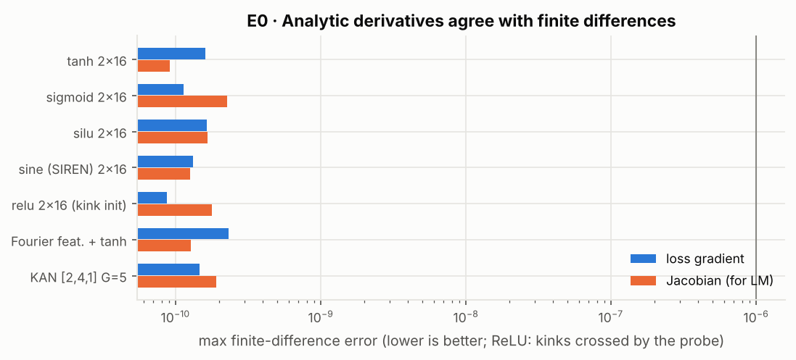
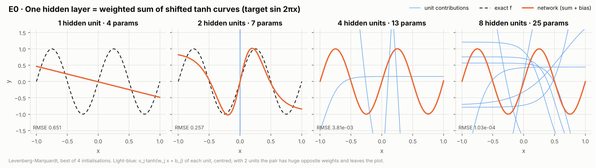

## E1 · Architecture (depth × width)

_Profile: **quick** · generated 2026-11-06 22:14_

Mean test RMSE over seeds (columns: width per hidden layer).

| target | depth | w=4 | w=8 | w=16 | w=32 | w=64 |
|---|---|---|---|---|---|---|
| f1 | 1 | 0.467 | 0.279 | 0.267 | 0.204 | 0.255 |
| f1 | 2 | 0.0381 | 0.0243 | 5.78e-03 | 1.98e-03 | 2.80e-03 |
| f1 | 3 | 0.0164 | 3.22e-03 | 2.71e-03 | 2.86e-03 | 4.32e-03 |
| f4 | 1 | 6.27e-03 | 2.10e-03 | 1.07e-03 | 6.87e-04 | 1.01e-03 |
| f4 | 2 | 9.99e-04 | 5.90e-04 | 2.91e-04 | 1.67e-04 | 1.25e-04 |
| f4 | 3 | 6.28e-04 | 3.72e-04 | 1.61e-04 | 2.59e-04 | 2.12e-04 |
| f5 | 1 | 0.0659 | 0.0425 | 0.0345 | 0.0313 | 0.0344 |
| f5 | 2 | 0.0348 | 0.0147 | 7.83e-03 | 6.57e-03 | 5.68e-03 |
| f5 | 3 | 0.032 | 8.90e-03 | 3.07e-03 | 1.58e-03 | 2.07e-03 |

Same parameter count, different shape:

- f1: 1×32 (97 params) RMSE 0.204 vs 2×8 (97 params) 0.0243 → ratio 8.4
- f4: 1×32 (97 params) RMSE 6.87e-04 vs 2×8 (97 params) 5.90e-04 → ratio 1.2

Best Franke network: [32, 32, 32] (2241 params), RMSE 1.36e-03.

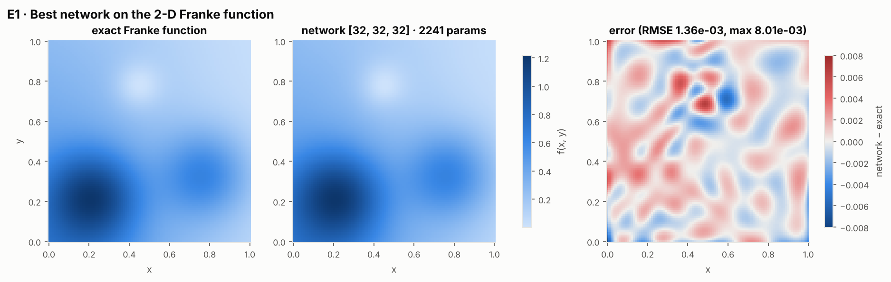
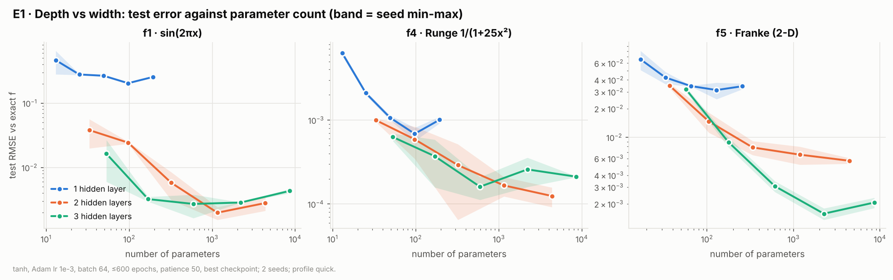

## E2 · Activation and initialisation

_Profile: **quick** · generated 2026-11-06 22:15_

Mean test RMSE, 2×32 network.

| variant | f1 | f4 | f6 |
|---|---|---|---|
| tanh | 1.98e-03 | 1.67e-04 | 1.61e-03 |
| sigmoid | 0.653 | 3.55e-04 | 0.0143 |
| SiLU | 2.12e-03 | 5.12e-04 | 2.17e-03 |
| ReLU, zero bias | 5.01e-03 | 9.14e-04 | 5.40e-05 |
| ReLU, kink init | 5.57e-03 | 1.03e-03 | 5.33e-05 |
| SIREN w0=10 | 6.54e-04 | 6.21e-04 | 1.08e-03 |
| SIREN w0=30 | 2.03e-03 | 1.97e-03 | 1.25e-03 |

ReLU 1×32 on f1 (hinge placement at initialisation):

| bias init | RMSE per seed | R² per seed |
|---|---|---|
| zero (all kinks at x=0) | 0.308, 0.0242 | 0.8100, 0.9988 |
| kink | 0.0163, 9.53e-03 | 0.9995, 0.9998 |

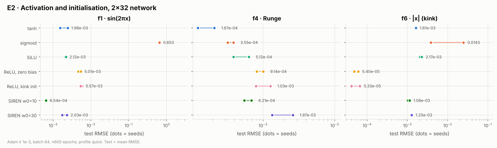
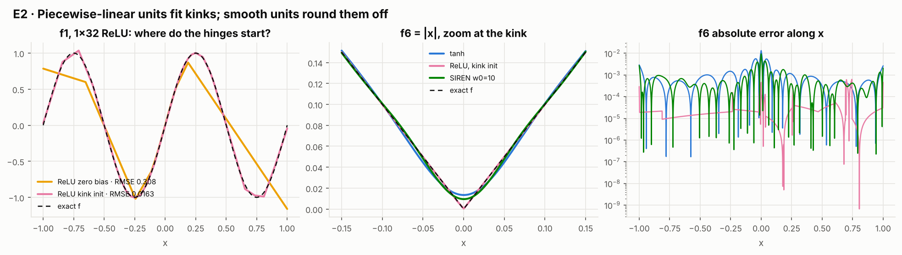

## E3 · Learning rate, batch size and optimiser

_Profile: **quick** · generated 2026-11-06 22:16_

Geometric-mean test RMSE (rows: batch size, columns: learning rate).

| batch | 0.0001 | 0.0003 | 0.001 | 0.003 | 0.01 | 0.03 |
|---|---|---|---|---|---|---|
| 16 | 1.52e-04 | 1.23e-04 | 1.58e-04 | 4.14e-04 | 9.22e-04 | 1.73e-03 |
| 64 | 4.23e-04 | 1.29e-04 | 1.61e-04 | 1.80e-04 | 4.75e-04 | 1.55e-03 |
| 256 | 0.0228 | 2.47e-03 | 4.35e-04 | 2.30e-04 | 4.93e-04 | 6.87e-04 |
| full | 0.266 | 0.0987 | 0.0116 | 2.47e-03 | 9.71e-04 | 9.75e-04 |

Optimisers (2×16 tanh, best lr of three):

| optimiser | lr | test RMSE | updates | seconds | stop |
|---|---|---|---|---|---|
| SGD | 0.1 | 8.79e-04 | 19200 | 1.1 | max epochs |
| SGD + momentum 0.9 | 0.01 | 9.03e-04 | 19200 | 1.6 | max epochs |
| Nesterov 0.9 | 0.01 | 9.00e-04 | 19200 | 1.7 | max epochs |
| Adam | 0.001 | 6.50e-05 | 18720 | 2.2 | early stop (patience 50) |
| Levenberg-Marquardt | - | 1.18e-06 | 300 | 3.1 | max iterations |

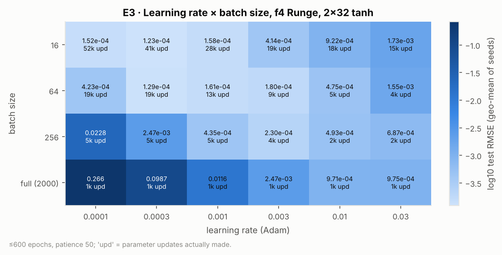
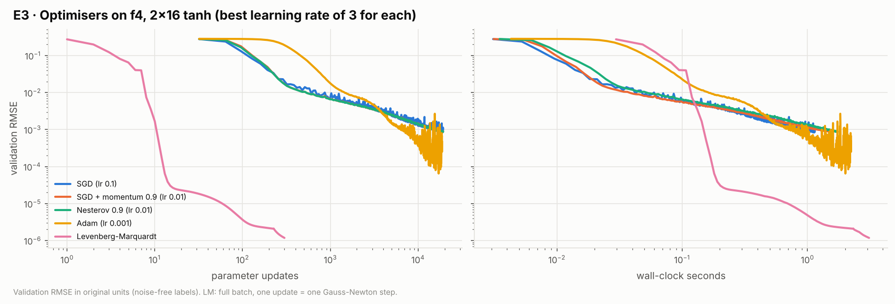

## E4 · Data size and noise

_Profile: **quick** · generated 2026-11-06 22:19_

Geometric-mean test RMSE vs exact f (rows σ and trainer, columns N). Trainer: Adam 2×32 batch 64 with constant or cosine-annealed learning rate, or Levenberg-Marquardt (lm) 2×16 full batch.

| σ | trainer | N=100 | N=250 | N=500 | N=1000 | N=2000 | N=5000 |
|---|---|---|---|---|---|---|---|
| 0 | constant | 1.81e-03 | 1.90e-03 | 1.71e-03 | 1.78e-03 | 1.93e-03 | 3.51e-03 |
| 0 | cosine | 2.15e-03 | 3.02e-03 | 2.84e-03 | 3.53e-03 | 3.66e-03 | 4.99e-03 |
| 0 | lm | 5.47e-05 | 3.47e-05 | 3.53e-05 | 4.17e-05 | 3.36e-05 | 3.94e-05 |
| 0.05 | constant | 0.0178 | 0.0148 | 0.0116 | 0.0118 | 0.0102 | 0.011 |
| 0.05 | cosine | 0.018 | 0.0161 | 0.0125 | 0.0128 | 0.012 | 0.0115 |
| 0.05 | lm | 0.0216 | 0.0131 | 9.27e-03 | 5.06e-03 | 4.55e-03 | 3.58e-03 |
| 0.1 | constant | 0.0405 | 0.0353 | 0.0189 | 0.0196 | 0.0152 | 0.0178 |
| 0.1 | cosine | 0.0379 | 0.0292 | 0.0207 | 0.0218 | 0.0178 | 0.017 |
| 0.1 | lm | 0.043 | 0.0221 | 0.0184 | 0.0162 | 0.0105 | 7.45e-03 |
| 0.2 | constant | 0.0756 | 0.0627 | 0.0415 | 0.0408 | 0.0229 | 0.0281 |
| 0.2 | cosine | 0.0745 | 0.0552 | 0.0432 | 0.0517 | 0.0287 | 0.0293 |
| 0.2 | lm | 0.0817 | 0.0466 | 0.0393 | 0.0251 | 0.0141 | 0.0147 |

LM is full batch and uses at most 4,000 training points (N = 5000 is subsampled).

Overfitting run (N=100, σ=0.2, 2×128): best validation epoch 3264; test MSE there 9.03e-03, at the last epoch 0.0184 (×2.0); final train MSE 0.0305 vs noise variance 0.04.

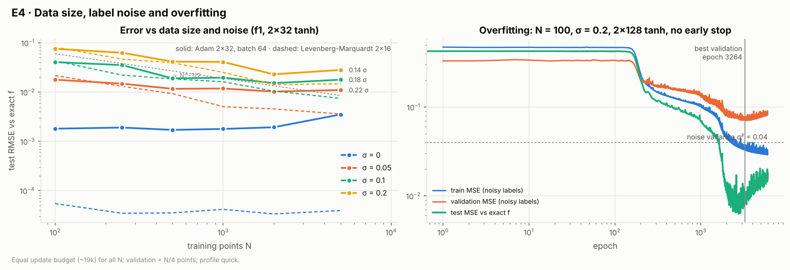

## E5 · Early stopping and weight decay

_Profile: **quick** · generated 2026-11-06 22:21_

| patience | mean test RMSE | mean best epoch |
|---|---|---|
| 5 | 0.656 | 3 |
| 15 | 0.652 | 18 |
| 50 | 0.652 | 18 |
| 200 | 0.0379 | 1994 |
| 1000 | 0.0398 | 3139 |

| λ (no early stop) | mean test RMSE |
|---|---|
| 0 | 0.0428 |
| 1e-05 | 0.0376 |
| 0.0001 | 0.0285 |
| 0.001 | 0.652 |
| 0.01 | 0.652 |

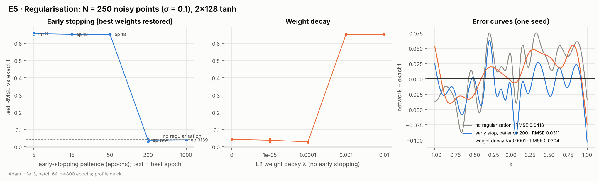

## E6 · Classical baselines at matched size

_Profile: **quick** · generated 2026-11-06 22:23_

| target | model | best RMSE | at size | best with 80-400 params |
|---|---|---|---|---|
| f1 | MLP 2×H · Adam | 1.54e-03 | 1153 | 3.10e-03 @ 321 |
| f1 | MLP 2×H · LM | 2.03e-05 | 321 | 2.03e-05 @ 321 |
| f1 | Chebyshev LS | 9.12e-16 | 33 | 1.66e-15 @ 97 |
| f1 | cubic spline LS | 6.87e-08 | 128 | 6.87e-08 @ 128 |
| f4 | MLP 2×H · Adam | 6.50e-05 | 321 | 6.50e-05 @ 321 |
| f4 | MLP 2×H · LM | 7.08e-07 | 193 | 7.08e-07 @ 193 |
| f4 | Chebyshev LS | 5.32e-09 | 97 | 5.32e-09 @ 97 |
| f4 | cubic spline LS | 2.01e-07 | 128 | 2.01e-07 @ 128 |
| f5 | MLP 2×H · Adam | 5.16e-03 | 1185 | 6.51e-03 @ 337 |
| f5 | MLP 2×H · LM | 1.10e-04 | 501 | 1.39e-04 @ 337 |
| f5 | Chebyshev LS | 1.31e-03 | 289 | 1.31e-03 @ 289 |
| f5 | cubic spline LS | 8.62e-05 | 400 | 8.62e-05 @ 400 |
| f6 | MLP 2×H · Adam | 1.09e-03 | 4353 | 2.16e-03 @ 97 |
| f6 | MLP 2×H · LM | 1.13e-04 | 193 | 1.13e-04 @ 193 |
| f6 | Chebyshev LS | 6.61e-04 | 97 | 6.61e-04 @ 97 |
| f6 | cubic spline LS | 2.19e-04 | 128 | 2.19e-04 @ 128 |

Runge function, interpolation:

| interpolant | coefficients | max error | RMSE |
|---|---|---|---|
| equispaced nodes, degree 10 | 11 | 1.92 | 0.58 |
| equispaced nodes, degree 20 | 21 | 59.8 | 11.9 |
| Chebyshev nodes, degree 20 | 21 | 0.0153 | 7.50e-03 |

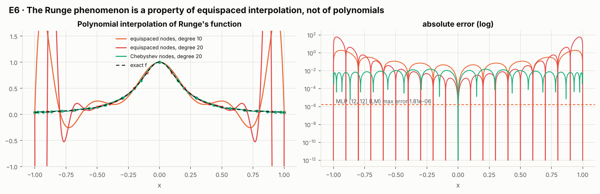
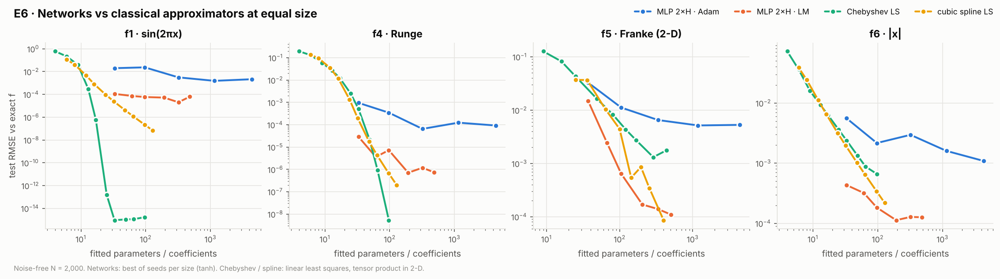

## U1 · Levenberg-Marquardt (second-order training)

_Profile: **quick** · generated 2026-11-06 22:24_

| target | method | median RMSE | best | worst | median seconds |
|---|---|---|---|---|---|
| f4 | Adam | 2.01e-04 | 6.50e-05 | 5.17e-04 | 1.6 |
| f4 | LM | 2.48e-06 | 9.08e-07 | 4.28e-06 | 3.5 |
| f4 | Adam → LM | 2.00e-06 | 4.81e-07 | 1.73e-05 | 3.8 |
| f5 | Adam | 7.73e-03 | 6.41e-03 | 9.32e-03 | 2.2 |
| f5 | LM | 1.44e-04 | 1.10e-04 | 3.39e-04 | 3.9 |
| f5 | Adam → LM | 1.27e-04 | 1.02e-04 | 1.72e-04 | 4.2 |

Median Adam/LM error ratio: f4 ×81, f5 ×54 (same network, same data; 6 seeds).

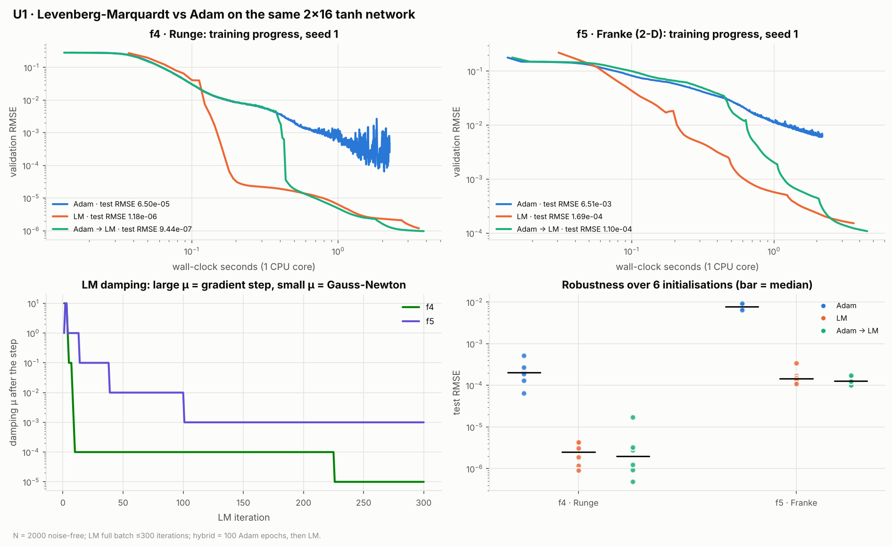

## U2 · KAN vs MLP

_Profile: **quick** · generated 2026-11-06 22:27_

| target | model | best RMSE | at params | best with 100-250 params | median s/run |
|---|---|---|---|---|---|
| f7 | MLP 2×H tanh | 2.11e-04 | 105 | 2.11e-04 @ 105 | 0.8 |
| f7 | KAN [d,5,1] | 1.34e-04 | 216 | 1.34e-04 @ 216 | 5.9 |
| f7 | KAN [2,1,1] | 3.83e-05 | 74 | - | 1.1 |
| f5 | MLP 2×H tanh | 1.39e-04 | 337 | 1.70e-04 @ 205 | 0.8 |
| f5 | KAN [d,5,1] | 2.17e-04 | 216 | 2.17e-04 @ 216 | 5.8 |
| f4 | MLP 2×H tanh | 7.08e-07 | 193 | 7.08e-07 @ 193 | 0.7 |
| f4 | KAN [d,5,1] | 4.65e-07 | 246 | 4.65e-07 @ 246 | 5.4 |
| f6 | MLP 2×H tanh | 1.13e-04 | 193 | 1.13e-04 @ 193 | 0.7 |
| f6 | KAN [d,5,1] | 5.03e-05 | 246 | 5.03e-05 @ 246 | 4.7 |

Symbolic check of KAN [2,1,1] on f7 (affine fit R² of each learned edge):

| edge | candidate | 1 − R² |
|---|---|---|
| inner x | sin(πx) | 6.2e-08 |
| inner y | y² | 4.3e-09 |
| outer | exp(s/0.60) | 1.8e-07 |

Grid extension run: final validation RMSE KAN 4.96e-05 (366 params) vs MLP 2×12 5.12e-04 (205 params).

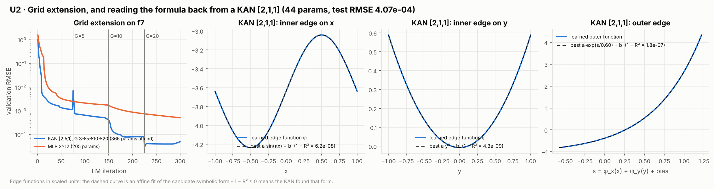
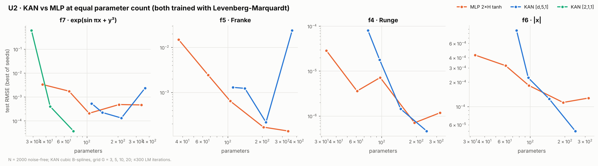

## U3 · Spectral bias

_Profile: **quick** · generated 2026-11-06 22:29_

Full-batch Adam, 3000 steps, lr 1e-3, one seed.

| model | params | final RMSE | step k=1 < 10 % | step k=4 < 10 % | step k=16 < 10 % |
|---|---|---|---|---|---|
| tanh MLP | 8513 | 0.111 | 100 | 650 | never |
| ReLU MLP | 8513 | 0.0962 | 25 | 225 | never |
| Fourier features + tanh | 8385 | 1.13e-03 | 25 | 50 | 100 |
| SIREN | 8513 | 0.0932 | 25 | 25 | 50 |
| KAN | 4065 | 2.28e-03 | 50 | 75 | 550 |

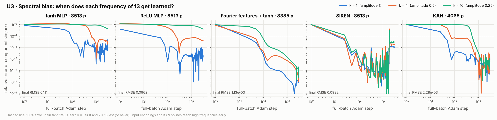
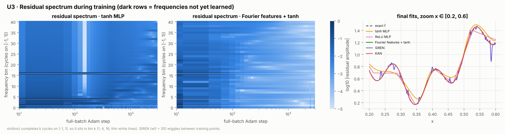

## U4 · Uncertainty: ensembles and conformal prediction

_Profile: **quick** · generated 2026-11-06 22:30_

Deep ensembles on f2 (trained on [-2, 2], evaluated on [-3, 3]):

| members | RMSE inside | RMSE outside | mean sd inside | mean sd outside | outside: abs error ≤ 2 sd |
|---|---|---|---|---|---|
| 5 × tanh | 0.0122 | 2.82 | 6.67e-03 | 0.148 | 0 % |
| 5 × relu | 0.0133 | 2.6 | 0.0131 | 0.458 | 11 % |

Split conformal on f1 with heteroscedastic noise (mean over 200 splits):

| nominal | plain coverage | plain width | weighted coverage | weighted width |
|---|---|---|---|---|
| 0.50 | 0.503 | 0.0873 | 0.503 | 0.123 |
| 0.70 | 0.702 | 0.162 | 0.702 | 0.185 |
| 0.80 | 0.802 | 0.23 | 0.802 | 0.226 |
| 0.90 | 0.902 | 0.366 | 0.902 | 0.288 |
| 0.95 | 0.952 | 0.489 | 0.951 | 0.346 |

Coverage at nominal 0.90 in the lowest / highest-noise bin: plain 1.000 / 0.611, weighted 0.956 / 0.883.

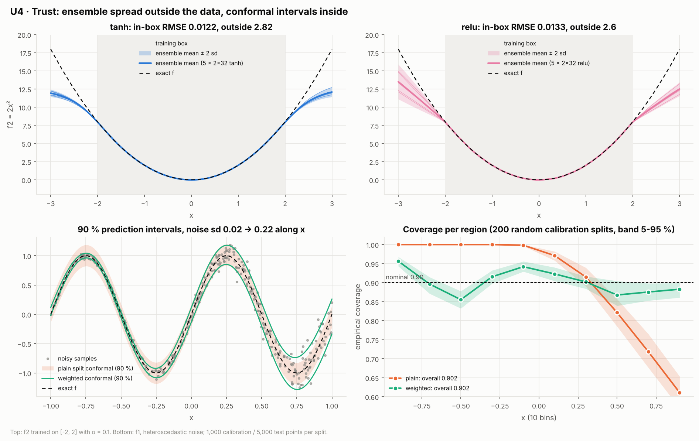
